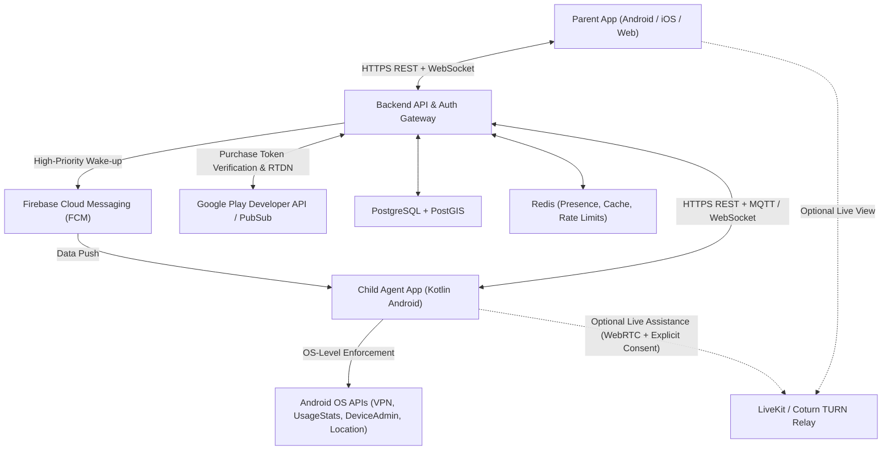

# Complete Developer & Business Blueprint: Parental Control App (Android + Backend)

> [!IMPORTANT]
> This blueprint specifies a **legitimate, transparent, consent-based, and Google Play–compliant** Parental Control platform (comparable in category to Google Family Link, Qustodio, or Bark). All monitoring features require explicit parent-child device pairing, prominent in-app disclosures, and persistent system notifications as required by Android OS and Google Play policies.

---

## 1. High-Level Architecture: Client-Side vs. Server-Side

A production parental control platform is **hybrid**—it cannot be 100% server-side and cannot be 100% client-side.



### Responsibilities Split
- **Child Device (Client-Side):**
  - Enforces app limits and blocking locally (even when offline or mobile data is turned off) using an encrypted local cache (Room + SQLCipher).
  - Runs local `VpnService` for DNS/domain filtering without routing all user browsing data through expensive proxy servers.
  - Collects batched GPS coordinates (`FusedLocationProviderClient`) and app usage stats (`UsageStatsManager`).
  - Displays a **persistent foreground notification** showing active parental protection.
- **Cloud Backend (Server-Side):**
  - Stores family accounts, pairing state, policies, and historical telemetry.
  - Validates subscriptions directly against Google Play / Apple servers (**Server-Side Truth**—client apps never decide premium status on their own).
  - Delivers instant rule updates and lock commands via FCM + WebSockets/MQTT.
  - Evaluates geofences, triggers parent push alerts, and serves historical charts.

---

## 2. Complete Tech Stack

### A. Child App (Android — Must Be Native Kotlin)
- **Language:** Kotlin 2.0+ (Jetpack Compose for setup/UI; pure Android SDK services for background enforcement). *Do not build the child enforcement engine in Flutter/React Native—you need direct control over `VpnService`, `AccessibilityService`, `UsageStatsManager`, `MediaProjection`, and `DevicePolicyManager`.*
- **Local Storage:** Room DB + SQLCipher (encrypted offline rule cache & telemetry queue) + **Tencent MMKV** (ultra-fast, crash-safe config cache) + EncryptedSharedPreferences (JWT/device keys).
- **Background Scheduling:** Foreground Services (`location`, `dataSync`, `specialUse`, `mediaProjection`) + `WorkManager` (periodic batch upload) + **Activity Recognition API** (reduces GPS polling when device is `STILL`, saving ~50–60% battery).
- **Networking:** Retrofit + OkHttp (TLS 1.3 & certificate pinning) + Kotlinx Serialization + **Baseline Profiles (`baseline.prof`)** for instant cold startup.

### B. Parent App (Fastest & Most Responsive Stack)
- **Primary Recommendation (Android-First Speed):** **Native Kotlin + Jetpack Compose (Material 3) + Baseline Profiles** — *Verified in both FlashGet Kids and KidsLink Parents.* Gives 60/120fps scrolling, smallest APK (~18–25 MB), instant cold start, and native WebRTC/MapLibre performance.
- **Cross-Platform Alternative (If iOS Parent App is needed Day 1):** **Flutter** (Impeller engine, single codebase for Android + iOS).
- **UX Polish:** **Lottie Compose** animations for live-connecting states (`Waiting for child device...`), **BiometricPrompt** (fingerprint/face lock for parent app), and **Vico / Compose Charts** for daily screen-time analytics.
- **Maps:** **MapLibre + OpenStreetMap / Protomaps** (near-zero tile cost) or Google Maps SDK (see Section 7 for cost optimization).

### C. Backend & Cloud Infrastructure (Sub-10ms Response Time)
- **API Framework:** **Go (Fiber / Gin)** *(recommended for lowest RAM & sub-10ms latency on a small VPS)* OR **Node.js (Fastify / NestJS + TypeScript)**.
- **Database:** PostgreSQL 16 + PostGIS extension (for geofencing polygons and spatial distance queries).
- **Cache / PubSub:** Redis 7+ (online/offline device heartbeat, rate limiting, cached subscription entitlements).
- **Real-Time Messaging:** Firebase Cloud Messaging (FCM High-Priority) for wake-up commands + EMQX (MQTT) or WebSockets for live active state.
- **Object Storage:** Cloudflare R2 (10 GB free tier, zero egress fees — for daily blocklist bundles, optional profile photos, exported reports).
- **Live Camera / Audio / Screen Mirroring:** **P2P WebRTC first (free) + Self-Hosted LiveKit / Coturn (STUN/TURN)** on VPS. *Avoid per-minute paid SDKs like Agora or Tencent TRTC at MVP stage—self-hosted WebRTC saves 80–90% at scale.*

---

## 3. PostgreSQL + PostGIS Database Schema (Production-Ready DDL)

Any backend developer can initialize the database directly from this schema:

```sql
CREATE EXTENSION IF NOT EXISTS "pgcrypto";
CREATE EXTENSION IF NOT EXISTS "postgis";

-- 1. Parent / Guardian Accounts
CREATE TABLE users (
    id UUID PRIMARY KEY DEFAULT gen_random_uuid(),
    email VARCHAR(255) UNIQUE NOT NULL,
    password_hash TEXT NOT NULL,
    full_name VARCHAR(120) NOT NULL,
    role VARCHAR(20) NOT NULL DEFAULT 'parent', -- 'parent' | 'co_parent'
    fcm_token TEXT,
    created_at TIMESTAMPTZ NOT NULL DEFAULT NOW(),
    deleted_at TIMESTAMPTZ
);

-- 2. Family Group
CREATE TABLE families (
    id UUID PRIMARY KEY DEFAULT gen_random_uuid(),
    owner_user_id UUID NOT NULL REFERENCES users(id) ON DELETE CASCADE,
    name VARCHAR(100) NOT NULL DEFAULT 'My Family',
    pin_hash TEXT, -- 4-6 digit parent PIN to unlock child device locally
    created_at TIMESTAMPTZ NOT NULL DEFAULT NOW()
);

CREATE TABLE family_members (
    family_id UUID NOT NULL REFERENCES families(id) ON DELETE CASCADE,
    user_id UUID NOT NULL REFERENCES users(id) ON DELETE CASCADE,
    role VARCHAR(20) NOT NULL DEFAULT 'parent',
    PRIMARY KEY (family_id, user_id)
);

-- 3. Subscriptions & Entitlements (Server-Side Source of Truth)
CREATE TABLE subscriptions (
    id UUID PRIMARY KEY DEFAULT gen_random_uuid(),
    family_id UUID NOT NULL REFERENCES families(id) ON DELETE CASCADE,
    provider VARCHAR(20) NOT NULL, -- 'google_play' | 'apple_app_store'
    product_id VARCHAR(100) NOT NULL, -- e.g. 'premium_monthly', 'premium_yearly'
    purchase_token TEXT UNIQUE NOT NULL,
    status VARCHAR(30) NOT NULL, -- 'active' | 'grace_period' | 'on_hold' | 'canceled' | 'expired'
    max_child_devices INT NOT NULL DEFAULT 1,
    history_retention_days INT NOT NULL DEFAULT 7,
    web_filter_enabled BOOLEAN NOT NULL DEFAULT FALSE,
    current_period_start TIMESTAMPTZ NOT NULL,
    current_period_end TIMESTAMPTZ NOT NULL,
    updated_at TIMESTAMPTZ NOT NULL DEFAULT NOW()
);

-- 4. Child Devices
CREATE TABLE devices (
    id UUID PRIMARY KEY DEFAULT gen_random_uuid(),
    family_id UUID NOT NULL REFERENCES families(id) ON DELETE CASCADE,
    child_name VARCHAR(80) NOT NULL,
    device_model VARCHAR(100),
    os_version VARCHAR(30),
    app_version VARCHAR(30),
    device_secret_hash TEXT NOT NULL,
    fcm_token TEXT,
    battery_level INT,
    is_locked BOOLEAN NOT NULL DEFAULT FALSE,
    last_seen_at TIMESTAMPTZ,
    permissions_state JSONB NOT NULL DEFAULT '{}'::jsonb,
    created_at TIMESTAMPTZ NOT NULL DEFAULT NOW()
);

-- 5. Short-Lived Pairing Codes (QR / 6-digit)
CREATE TABLE pairing_codes (
    code VARCHAR(12) PRIMARY KEY,
    family_id UUID NOT NULL REFERENCES families(id) ON DELETE CASCADE,
    child_name VARCHAR(80) NOT NULL,
    expires_at TIMESTAMPTZ NOT NULL,
    used_at TIMESTAMPTZ
);

-- 6. Device Policies (Versioned for Delta Sync)
CREATE TABLE device_policies (
    device_id UUID PRIMARY KEY REFERENCES devices(id) ON DELETE CASCADE,
    version BIGINT NOT NULL DEFAULT 1,
    daily_screen_limit_mins INT, -- NULL = unlimited
    bedtime_start TIME, -- e.g. '21:30:00'
    bedtime_end TIME,   -- e.g. '07:00:00'
    timezone VARCHAR(64) NOT NULL DEFAULT 'UTC',
    web_filter_mode VARCHAR(20) NOT NULL DEFAULT 'off', -- 'off' | 'safe_search' | 'strict'
    blocked_categories JSONB NOT NULL DEFAULT '[]'::jsonb, -- ['adult', 'gambling', 'social']
    custom_blocked_domains JSONB NOT NULL DEFAULT '[]'::jsonb,
    updated_at TIMESTAMPTZ NOT NULL DEFAULT NOW()
);

-- 7. Per-App Rules
CREATE TABLE app_rules (
    id UUID PRIMARY KEY DEFAULT gen_random_uuid(),
    device_id UUID NOT NULL REFERENCES devices(id) ON DELETE CASCADE,
    package_name VARCHAR(255) NOT NULL,
    app_label VARCHAR(150),
    rule_type VARCHAR(20) NOT NULL, -- 'allow' | 'block' | 'time_limit'
    daily_limit_mins INT,
    schedule_json JSONB, -- Optional school/homework windows
    UNIQUE (device_id, package_name)
);

-- 8. Geofences (Safe Zones)
CREATE TABLE geofences (
    id UUID PRIMARY KEY DEFAULT gen_random_uuid(),
    device_id UUID NOT NULL REFERENCES devices(id) ON DELETE CASCADE,
    name VARCHAR(80) NOT NULL, -- e.g. 'Home', 'School'
    center GEOGRAPHY(POINT, 4326) NOT NULL,
    radius_meters INT NOT NULL DEFAULT 150,
    notify_on_enter BOOLEAN NOT NULL DEFAULT TRUE,
    notify_on_exit BOOLEAN NOT NULL DEFAULT TRUE
);
CREATE INDEX idx_geofences_center ON geofences USING GIST(center);

-- 9. Location History (Partition by month in production)
CREATE TABLE location_logs (
    id BIGSERIAL,
    device_id UUID NOT NULL REFERENCES devices(id) ON DELETE CASCADE,
    coords GEOGRAPHY(POINT, 4326) NOT NULL,
    accuracy_meters REAL,
    battery_level INT,
    recorded_at TIMESTAMPTZ NOT NULL,
    PRIMARY KEY (id, recorded_at)
) PARTITION BY RANGE (recorded_at);

-- Example initial partition:
-- CREATE TABLE location_logs_2026_11 PARTITION OF location_logs
--     FOR VALUES FROM ('2026-11-01') TO ('2026-12-01');
CREATE INDEX idx_location_device_time ON location_logs (device_id, recorded_at DESC);

-- 10. Daily App Usage Summary
CREATE TABLE app_usage_daily (
    device_id UUID NOT NULL REFERENCES devices(id) ON DELETE CASCADE,
    usage_date DATE NOT NULL,
    package_name VARCHAR(255) NOT NULL,
    app_label VARCHAR(150),
    foreground_ms BIGINT NOT NULL DEFAULT 0,
    launch_count INT NOT NULL DEFAULT 0,
    PRIMARY KEY (device_id, usage_date, package_name)
);

-- 11. Alerts & Events (SOS, Geofence, Blocked Attempts)
CREATE TABLE alerts (
    id UUID PRIMARY KEY DEFAULT gen_random_uuid(),
    family_id UUID NOT NULL REFERENCES families(id) ON DELETE CASCADE,
    device_id UUID NOT NULL REFERENCES devices(id) ON DELETE CASCADE,
    alert_type VARCHAR(40) NOT NULL, -- 'SOS' | 'GEOFENCE_ENTER' | 'GEOFENCE_EXIT' | 'WEB_BLOCKED' | 'PERMISSION_REVOKED'
    payload JSONB NOT NULL DEFAULT '{}'::jsonb,
    is_read BOOLEAN NOT NULL DEFAULT FALSE,
    created_at TIMESTAMPTZ NOT NULL DEFAULT NOW()
);
CREATE INDEX idx_alerts_family_created ON alerts (family_id, created_at DESC);
```

---

## 4. Complete Backend API & Push Command Contract

### A. Authentication & Pairing
- `POST /api/v1/auth/register` -> `{ email, password, fullName }` -> `201 Created` (`accessToken`, `refreshToken`, `user`)
- `POST /api/v1/auth/login` -> `{ email, password, fcmToken }` -> `200 OK`
- `POST /api/v1/family/pairing-code` (Parent Auth) -> `{ childName }` -> Returns `{ "code": "849201", "qrPayload": "app://pair?code=849201", "expiresAt": "..." }`
- `POST /api/v1/device/pair` (Public + Code) -> `{ code, deviceModel, osVersion, appVersion, fcmToken }` -> Returns `{ deviceId, deviceAccessToken, policy }`

### B. Policy & Instant Commands
- `GET /api/v1/devices/:deviceId/policy`
  Returns complete JSON policy + `version` integer so the child app only overwrites local Room DB when `serverVersion > localVersion`:
  ```json
  {
    "version": 14,
    "isLocked": false,
    "dailyScreenLimitMins": 120,
    "bedtime": { "start": "21:30", "end": "07:00", "timezone": "Asia/Kolkata" },
    "webFilter": {
      "mode": "strict",
      "blockedCategories": ["adult", "gambling"],
      "customBlockedDomains": ["example-bad-site.com"]
    },
    "appRules": [
      { "packageName": "com.zhiliaoapp.musically", "ruleType": "block", "dailyLimitMins": null },
      { "packageName": "com.google.android.youtube", "ruleType": "time_limit", "dailyLimitMins": 45 }
    ]
  }
  ```
- `PUT /api/v1/devices/:deviceId/policy` (Parent Auth) -> Updates DB, increments `version`, pushes silent high-priority FCM to child:
  ```json
  {
    "data": {
      "type": "SYNC_POLICY",
      "policyVersion": "15",
      "timestamp": "2026-11-12T10:15:00Z"
    },
    "android": { "priority": "high" }
  }
  ```
- `POST /api/v1/devices/:deviceId/commands` (Parent Auth) -> `{ "command": "LOCK_NOW" | "UNLOCK" | "PING_LOCATION" | "RING_SOS" }`

### C. Batched Telemetry Endpoints (Battery & Cost Efficient)
- `POST /api/v1/telemetry/location` (Child Auth)
  ```json
  {
    "batteryLevel": 72,
    "points": [
      { "lat": 28.6139, "lng": 77.2090, "accuracy": 14.5, "recordedAt": "2026-11-12T10:00:00Z" },
      { "lat": 28.6142, "lng": 77.2095, "accuracy": 12.0, "recordedAt": "2026-11-12T10:10:00Z" }
    ]
  }
  ```
  *Backend action:* Bulk insert into `location_logs`, run PostGIS `ST_DWithin` against `geofences`, create `alerts` + push notification to parent if boundary crossed.
- `POST /api/v1/telemetry/app-usage` (Child Auth)
  ```json
  {
    "usageDate": "2026-11-12",
    "apps": [
      { "packageName": "com.whatsapp", "appLabel": "WhatsApp", "foregroundMs": 1420000, "launchCount": 18 }
    ]
  }
  ```
- `POST /api/v1/telemetry/installed-apps` (Child Auth) -> Syncs newly installed/uninstalled apps so the parent sees them in the app-blocking dashboard.

### D. Subscription Verification & Enforcement (Google Play Billing)
Never trust a boolean like `isPremium: true` sent by the mobile app. Always verify via Google Play Developer API:
1. Parent buys subscription via **Google Play Billing Library v7+**.
2. Parent app sends `purchaseToken` and `productId` to `POST /api/v1/billing/google/verify`.
3. Backend uses a Google Cloud Service Account (`androidpublisher` scope) to call `purchases.subscriptionsv2.get` on Google Play Developer API.
4. Backend writes verified `status` & `current_period_end` to `subscriptions` table and caches entitlements in Redis (`family:{id}:entitlements`).
5. **Real-Time Developer Notifications (RTDN):** Configure Google Cloud Pub/Sub -> `POST /api/v1/billing/google/rtdn` webhook so renewals, grace periods, cancellations, and refunds update automatically without the user opening the app.

---

## 5. Child App Android Implementation Blueprint (`AndroidManifest.xml` & OS APIs)

### Required Permissions & Services
```xml
<!-- Network & Wakeup -->
<uses-permission android:name="android.permission.INTERNET" />
<uses-permission android:name="android.permission.ACCESS_NETWORK_STATE" />
<uses-permission android:name="android.permission.RECEIVE_BOOT_COMPLETED" />
<uses-permission android:name="android.permission.POST_NOTIFICATIONS" />
<uses-permission android:name="android.permission.REQUEST_IGNORE_BATTERY_OPTIMIZATIONS" />

<!-- Location & Foreground Services (Android 14+ requires specific FGS types) -->
<uses-permission android:name="android.permission.ACCESS_COARSE_LOCATION" />
<uses-permission android:name="android.permission.ACCESS_FINE_LOCATION" />
<uses-permission android:name="android.permission.ACCESS_BACKGROUND_LOCATION" />
<uses-permission android:name="android.permission.FOREGROUND_SERVICE" />
<uses-permission android:name="android.permission.FOREGROUND_SERVICE_LOCATION" />
<uses-permission android:name="android.permission.FOREGROUND_SERVICE_DATA_SYNC" />

<!-- App Usage & Blocking (Requires Play Console Declaration & User Consent) -->
<uses-permission android:name="android.permission.PACKAGE_USAGE_STATS" tools:ignore="ProtectedPermissions" />
<uses-permission android:name="android.permission.QUERY_ALL_PACKAGES" tools:ignore="QueryAllPackagesPermission" />
<uses-permission android:name="android.permission.SYSTEM_ALERT_WINDOW" />
```

### Key Android Components to Implement
1. **Monitor Foreground Service (`MonitorForegroundService.kt`):**
   - Declared with `android:foregroundServiceType="location|dataSync"`.
   - Shows persistent notification: *"Parental Protection Active — Managed by Parent"*.
   - Restarts automatically on `BOOT_COMPLETED` and `MY_PACKAGE_REPLACED`.
2. **App Usage & Blocker Engine:**
   - Uses `UsageStatsManager.queryEvents()` every 1–2 seconds (when screen is ON, paused when screen is OFF via `ACTION_SCREEN_OFF` receiver to save battery) OR `AccessibilityService` (`TYPE_WINDOW_STATE_CHANGED`) to detect foreground package switches accurately.
   - When a blocked app or expired-limit app opens -> launches full-screen `BlockedAppActivity` (`FLAG_ACTIVITY_NEW_TASK | FLAG_ACTIVITY_CLEAR_TOP`) with a "Request More Time" button and "Parent PIN Override".
3. **Local Web Filter (`DnsVpnService.kt` extending `VpnService`):**
   - Intercepts UDP port `53` (DNS) packets from the TUN interface, extracts queried domain name, checks against local SQLite/Bloom-filter blocklist (synced from CDN/backend), and returns `NXDOMAIN` or `0.0.0.0` if blocked—otherwise forwards DNS query to clean upstream resolver (e.g., Cloudflare Family `1.1.1.3` / Google `8.8.8.8`).
   - *Advantage:* Zero proxy server bandwidth cost, ultra-fast browsing, works across Chrome and in-app browsers.
   - *Limitation:* Android allows only 1 active VPN; if Chrome uses Private DNS (DoT) or VPN-bypass, show an alert to parent or disable Private DNS guidance during setup.
4. **Device Admin (`DeviceAdminReceiver`):**
   - Prevents child from uninstalling the app casually without parent authentication.
   - Configured in `res/xml/device_admin.xml`.
5. **OEM Battery Optimization Wizard:**
   - Custom onboarding checklist detecting manufacturer (`Build.MANUFACTURER`) for Xiaomi, Oppo, Vivo, Realme, Samsung, OnePlus, guiding the parent to allow **Autostart** and **Unrestricted Battery** so the OS does not kill the service after 15 minutes.

---

## 6. Distribution & Compliance: Direct APK (Website) vs. Play Store

If you distribute via **Direct APK Download from your website (cPanel)** instead of Google Play Store:
- **Advantages:** No Play Store review rejections for `QUERY_ALL_PACKAGES`, `AccessibilityService`, `MediaProjection`, or background `Camera`/`Audio` features.
- **What You Must Still Handle for Android OS:**
  1. **Android 13–15 Restricted Settings:** Sideloaded APKs have Accessibility & Notification Listener locked by default until the parent taps *"Allow restricted settings"* in App Info (your onboarding wizard must guide the parent through this 2-tap step).
  2. **Google Play Protect:** Always sign release APKs with a consistent **Release Keystore**, serve over **HTTPS** from your domain, and keep **Prominent In-App Disclosures** + persistent protection notification so Play Protect does not flag the app as unknown/harmful.
  3. **Privacy & Legal (COPPA / GDPR-K / India DPDP):** Keep a public Privacy Policy and Account/Data Deletion page on your cPanel website, and auto-purge raw `location_logs` older than plan retention.

---

## 7. Third-Party APIs & Services Comparison

| Need | Recommended Option | Alternative | Cost & Engineering Notes |
| :--- | :--- | :--- | :--- |
| **Maps & Reverse Geocoding** | **Mapbox** or **MapLibre + OSM** | **Google Maps Platform** | Google Maps Geocoding is \$5 per 1,000 requests after free credit. **Rule:** Never geocode every GPS ping; only geocode on-demand when parent opens map + cache by rounded lat/lng (~50m grid). |
| **Push Notifications** | **Firebase Cloud Messaging (FCM)** | OneSignal | FCM is completely **free** and native to Android wake-up priority. |
| **Web Blocklists** | **OISD / Hagezi / StevenBlack lists** (CDN hosted) + `1.1.1.3` DNS | Webshrinker / Cloudflare Gateway API | Open-source categorized domain lists compressed to a ~2–5 MB Bloom filter cost near **\$0**. |
| **Subscription Infrastructure** | **Google Play Billing v7 + Backend RTDN** | **RevenueCat** | RevenueCat handles Google + Apple validation, webhooks, and grace periods out of the box (free up to \$2.5k MTR, then ~1%). |
| **Crash & Error Tracking** | **Sentry** + **Firebase Crashlytics** | Bugsnag | Essential for catching OEM-specific crashes (MIUI/ColorOS/Android 15). |
| **Live Screen/Audio (Optional Phase 2)** | **LiveKit (Self-hosted SFU + Coturn)** | Agora / Twilio | Agora/Twilio charge per participant-minute; self-hosted LiveKit + Coturn on Hetzner/AWS is much cheaper at scale. |

---

## 8. Complete Cost Breakdown, cPanel Reality Check & Unit Economics

### A. Can You Use Your Existing cPanel Hosting? (Hybrid Strategy)
You **already have cPanel hosting**, which saves money on web/legal assets, **but shared cPanel hosting cannot run the full real-time backend alone**:

| Component | Can Run on Existing cPanel? | Why / Recommendation |
| :--- | :--- | :--- |
| **Landing Page, Privacy Policy, Account Deletion Web Form** | **YES (\$0 extra)** | Mandatory for Google Play Store; static HTML/PHP works great on cPanel. |
| **Web Admin Dashboard (Static / PHP)** | **YES (\$0 extra)** | You can host your support/admin web portal on cPanel. |
| **Main API + WebSockets / MQTT** | **NO (Use Cloud VPS)** | Shared cPanel kills long-running processes & limits concurrent socket connections. |
| **PostgreSQL + PostGIS + Redis** | **NO (Use Cloud VPS)** | Shared cPanel rarely supports PostGIS spatial extensions or dedicated Redis. |
| **Live Camera / Screen Mirroring (`Coturn` / `LiveKit`)** | **NO (Use Cloud VPS)** | WebRTC TURN relays require root access and open UDP ports (`3478`, `50000–60000`). |

> [!TIP]
> **Best Low-Cost Setup:** Keep your **cPanel hosting** for your website, Privacy Policy, and Play Store Account Deletion page (\$0 extra), and add **1 Docker Cloud VPS** (e.g., Hetzner / Hostinger KVM / DigitalOcean at **\$6 – \$15/month** ≈ ₹500 – ₹1,250/month) to run `Go/Fastify API + PostgreSQL/PostGIS + Redis + Coturn`.

### B. One-Time & Launch Costs (USD & Approx. INR)
| Item | Estimated Cost | Details |
| :--- | :--- | :--- |
| **Google Play Developer Account** | **\$25** (~₹2,100) | One-time registration fee. |
| **Apple Developer Account** | **\$99 / year** (~₹8,500/yr) | Required *only* if launching an iOS Parent/Child app. |
| **Domain + cPanel Hosting** | **\$0** (Already owned) | Reuse your existing cPanel hosting for web/legal/deletion pages. |
| **Privacy Policy & Legal (COPPA / GDPR-K / DPDP)** | **\$0 – \$100** (₹0 – ₹8,500) | Template + customization for children's data compliance. |
| **UI/UX Design (Figma)** | **\$0 – \$1,500** | \$0 if built directly in Compose/Material 3; \$500–\$1,500 if outsourced. |
| **Engineering Effort** | **\$0 (In-house/AI)** or **\$6,000 – \$25,000+** | **MVP (3–4 months):** Auth, Pairing, App Block, Screen Time, Location, Web Filter, Billing. |

### C. Monthly Infrastructure Cost Estimates (All-In)

*Baseline assumptions: 1.5 child devices per family, activity-aware batched GPS uploads, open-source DNS blocklist on Cloudflare R2, geocoding cached, P2P WebRTC + self-hosted Coturn with daily minute quotas.*

| Service | MVP (0 – 1,000 Families) | Growth (10,000 Families) | Scale (100,000 Families) |
| :--- | :--- | :--- | :--- |
| **Cloud VPS (API + PostGIS + Redis + Coturn)** | **\$6 – \$15 / mo** (~₹500 – ₹1,250) | **\$80 – \$180 / mo** | **\$600 – \$1,400 / mo** |
| **cPanel Hosting (Website / Legal / Deletion URL)** | **\$0** (Existing) | **\$0** (Existing) | **\$0** (Existing) |
| **Object Storage & CDN (Cloudflare R2)** | **\$0** (10 GB Free) | **\$5 – \$15 / mo** | **\$50 – \$150 / mo** |
| **Maps & Geocoding (MapLibre + Cached)** | **\$0 – \$5 / mo** | **\$40 – \$150 / mo** | **\$350 – \$1,000 / mo** |
| **FCM Push Notifications** | **\$0** (Free) | **\$0** (Free) | **\$0** (Free) |
| **Crash & Error Tracking (Sentry / Crashlytics)** | **\$0** (Free tier) | **\$29 / mo** | **\$100 – \$250 / mo** |
| **Total Monthly Infra** | **~\$6 – \$20 / mo (₹500 – ₹1,700)** | **~\$155 – \$375 / mo** | **~\$1,100 – \$2,800 / mo** |

### D. Pricing & Margin Reality Check (Avoid Losing Money!)
- **Why Agora / Tencent TRTC (used by KidsLink & FlashGet) is risky for startups:** Commercial RTC SDKs charge ~\$0.99–\$3.99 per 1,000 video/screen minutes. Uncapped live streaming can wipe out your subscription profit. **Always use P2P WebRTC first + self-hosted Coturn + daily minute caps** (e.g., 15–30 mins/day on PRO).
- **Google Play Commission:** Google takes **15%** on subscriptions (under the 15% subscription/reduced tier).
- **Free Tier Trap:** Never give **free users** continuous GPS history, frequent map refreshes, or live WebRTC streaming—free users only get basic local screen-time/app-blocking (zero server cost per user!), while **cloud-heavy features** (location history, multi-child, geofencing alerts, web filter updates, live assistance) stay in the paid plan (e.g., **₹199–₹499/month** in India or **\$4.99–\$9.99/month** globally).

---

## 9. Recommended Project Repository Structure

If you hand this blueprint to a team, structure the monorepo/workspace cleanly into 3 modules:

```text
parental-control-platform/
├── backend/                     # NestJS / Go API + Workers + PostGIS migrations
│   ├── src/modules/auth/
│   ├── src/modules/family/
│   ├── src/modules/policy/
│   ├── src/modules/telemetry/
│   ├── src/modules/billing/     # Google Play RTDN + Receipt verification
│   └── migrations/
├── child-android/               # Native Kotlin Android Project
│   ├── app/src/main/java/.../
│   │   ├── services/            # MonitorForegroundService, DnsVpnService, AppAccessibilityService
│   │   ├── admin/               # DeviceAdminReceiver
│   │   ├── data/                # Room + SQLCipher + Retrofit
│   │   └── ui/                  # Onboarding, Permission Wizard, BlockedAppActivity
└── parent-app/                  # Flutter / React Native (Android + iOS)
    ├── lib/features/auth/
    ├── lib/features/dashboard/
    ├── lib/features/location_map/
    ├── lib/features/rules/
    └── lib/features/subscription/
```

---

## 10. Step-by-Step Execution Roadmap (16 Weeks)

1. **Weeks 1–2 (Foundation):** Set up PostgreSQL + PostGIS, Auth/Pairing API, Google Play Billing verification service, and domain blocklist CDN pipeline.
2. **Weeks 3–7 (Child Core Engine):** Build Kotlin Child App—Permission/OEM Battery Wizard, `UsageStatsManager` collector, `AccessibilityService` + Overlay app blocker, `FusedLocationProviderClient` batched uploader, and `DnsVpnService`.
3. **Weeks 8–11 (Parent App & Real-Time):** Build Parent App—QR Pairing, Screen-Time Dashboard, App Rules editor, Map + Geofence editor, FCM real-time push sync, and Paywall.
4. **Weeks 12–14 (Real-Device OEM Hardening):** Test extensively on physical **Xiaomi, Oppo/Realme, Vivo, Samsung, and Pixel** phones (Android 11 through 15). Fix background kills, Doze mode delays, and notification edge cases.
5. **Weeks 15–16 (Play Console Compliance & Launch):** Record required Prominent Disclosure & Permission videos, complete Data Safety & Families forms, and ship via Closed Beta first to clear Play Store policy reviews cleanly.

---

## 11. How to Beat FlashGet Kids & KidsLink (Advanced Differentiators)

Based on our deep analysis of both reference APKs (`Competitor_Deep_Analysis_Report.md`), here is how our app can be faster, leaner, and more advanced:

1. **Lean 20 MB APK vs. 73–113 MB Bloat:** Skip heavy Chinese push/map SDKs for global/Indian Play Store builds; use Native Kotlin + Jetpack Compose + `baseline.prof` for instant cold startup.
2. **Activity-Aware Battery Saving:** Use Google Play Services `ActivityRecognitionClient` so GPS only polls frequently when the child is moving (`WALKING` / `IN_VEHICLE`) and pauses when `STILL`—delivering noticeably better battery life than constant background polling.
3. **Zero-Cost P2P WebRTC First:** Attempt direct peer-to-peer WebRTC before falling back to your self-hosted Coturn/LiveKit VPS, cutting streaming costs by 70–85% compared to Agora or Tencent TRTC.
4. **On-Device AI Safety Alerts (Phase 2):** Run lightweight **TensorFlow Lite / MediaPipe** models locally on the child device to flag explicit content or cyberbullying keywords and send *text-only alerts* to the parent—preserving child privacy and avoiding expensive cloud GPU/storage bills.
5. **Instant Permission-Tamper & Uninstall Guard:** Combine `DeviceAdminReceiver` + periodic permission health checks so if any monitoring permission (`UsageStats`, `Accessibility`, `Location`, `VPN`) is revoked, the parent receives an immediate push alert.

