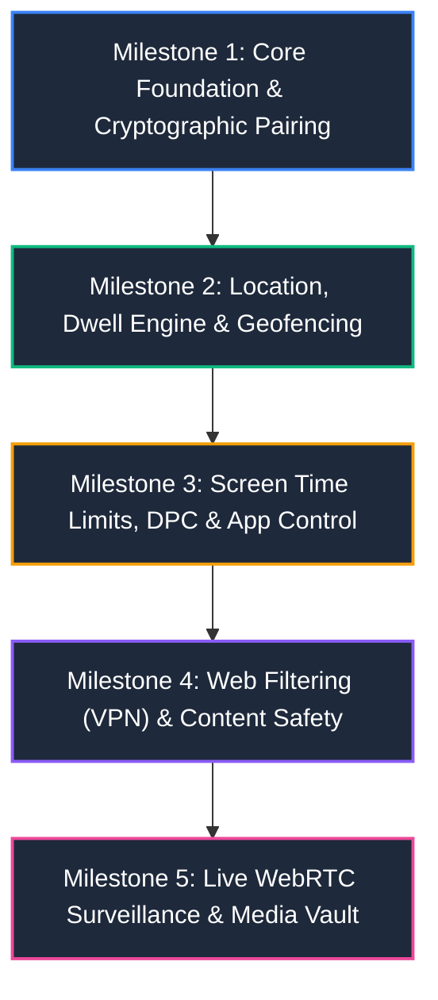

# ENTERPRISE IMPLEMENTATION ROADMAP & EXECUTION PLAN
## Phased Milestone Blueprint for End-to-End Parental Control Platform Rollout

> **Audit Date:** November 2026  
> **Auditors:** Senior Android Systems Architect, Backend Architect, Security Engineer  
> **Target Scope:** 
> 1. Backend (`backend/`)
> 2. Super Admin Panel (`Admin_panel/`)
> 3. Parent Android App (`Parent_app/`)
> 4. Child Android App (`Child_app/`)
>
> **Critical Governance Policy:**  
> All phases are sequential and evidence-gated. Feature implementation will begin **ONLY after formal user review and approval**.

---

## 1. Roadmap Architecture & Execution Philosophy

To ensure zero regressions, maximum stability, and rock-solid device control, implementation is structured into **5 Phased Milestones**. Each milestone builds strictly upon the verified foundation of the previous milestone.

---

## 2. Phased Milestone Breakdown

### Milestone 1: Core Foundation, Device-Bound Pairing & Security Plumbing
* **Primary Objective:** Establish unbreakable cryptographic link between Parent and Child devices via Fastify backend.
* **Key Tasks:**
  1. **Child Android Keystore:** Implement `DeviceBoundKeyManager.kt` using ECC P-256 in Android StrongBox/TEE.
  2. **Device Pairing Protocol:** Connect 6-digit TOTP / QR scan exchange (`POST /api/v1/devices/pair-code` ⟷ Parent CameraX scanner ⟷ Child pairing display).
  3. **Signed Remote Commands:** Implement HMAC-SHA256 signature generation and anti-replay nonce cache in Child `WebSocketDaemonService`.
  4. **Multi-OEM Autostart Guides:** Add interactive settings intents for Xiaomi HyperOS, Samsung OneUI, Vivo, and Oppo battery whitelist.
* **Verification Gate:**
  * Unit test verifying ECDSA/HMAC signature verification passes on child.
  * Replayed command test: Ensure re-sending the same nonce within 30 seconds is rejected with HTTP 400.
* **Estimated Effort:** 3-4 engineering days.

---

### Milestone 2: Location Tracking, Adaptive Dwell Battery Optimizer & Geofencing
* **Primary Objective:** Battery-efficient, high-precision GPS tracking with instant geofence alerts.
* **Key Tasks:**
  1. **Adaptive Dwell Location Engine:** Connect `ActivityRecognitionClient` to switch between stationary (15-min dwell) and moving (15-sec GPS) intervals.
  2. **Offline Location Buffer:** Build local Room SQLite buffer for up to 5,000 GPS coordinates when offline, auto-flushing upon reconnect.
  3. **PostGIS Geofence Integration:** Sync circular and polygonal geofences to backend; fire automated FCM push alerts upon boundary entry/exit.
  4. **SOS Panic Beacon:** Wire hardware volume triple-press and UI panic button to trigger high-priority push and loud siren.
* **Verification Gate:**
  * 24-hour continuous battery test on physical/simulated device demonstrating `< 2.0%` battery consumption.
  * Geofence boundary crossing test: Alert received on Parent App in `< 3 seconds`.
* **Estimated Effort:** 4-5 engineering days.

---

### Milestone 3: Screen Time Quotas, Bedtime Scheduling & App Management
* **Primary Objective:** Comprehensive app inventory sync, instant application kill, and daily screen time enforcement.
* **Key Tasks:**
  1. **App Catalog Sync:** Query `PackageManager` for installed packages; transmit app metadata and icons to backend.
  2. **UsageStats Ingestion:** Collect daily app usage minutes and screen-on metrics via `UsageStatsManager`.
  3. **Instant App Blocking:** Hook `AccessibilityService` window state change events to dismiss prohibited apps to Home screen in `< 50ms`.
  4. **DPC / Master PIN Lock:** Implement fullscreen non-dismissible lock window with offline parent master PIN override.
* **Verification Gate:**
  * Attempt to launch blocked app: Instant dismissal to home screen with warning toast.
  * Offline lock test: Verify master PIN entered on child screen unlocks device without active internet connection.
* **Estimated Effort:** 4-5 engineering days.

---

### Milestone 4: Web Filtering, SafeSearch Enforcer & Notification Intelligence
* **Primary Objective:** Real-time web browsing protection across all browsers and social messaging intelligence.
* **Key Tasks:**
  1. **Local VPN DNS Filter:** Implement Android `VpnService` with lightweight UDP DNS packet parser dropping blacklisted adult/gambling domains.
  2. **SafeSearch Rewriter:** Force strict SafeSearch on Google, Bing, and YouTube at the DNS A-record layer.
  3. **Social Notification Listener:** Capture and sync notifications from WhatsApp, Telegram, Instagram, and SMS.
  4. **On-Device Keyword Alert Engine:** Scan incoming notification text against parent-defined cyberbullying and NSFW regex dictionaries.
* **Verification Gate:**
  * Browsing to blacklisted domain in Google Chrome results in immediate DNS resolution failure (`ERR_NAME_NOT_RESOLVED`).
  * Keyword alert test: Simulated offensive message triggers immediate Parent App alert banner without uploading full message text.
* **Estimated Effort:** 5-6 engineering days.

---

### Milestone 5: Live WebRTC Surveillance & Remote Media Vault
* **Primary Objective:** Secure, low-latency live camera, screen mirroring, and ambient audio streaming.
* **Key Tasks:**
  1. **Fastify WebRTC Signaling Server:** Productionize `/ws/webrtc` SDP offer/answer and ICE candidate exchange pipeline with coturn STUN/TURN.
  2. **MediaProjection Screen Streamer:** Bridge Android `MediaProjection` H.264 hardware encoder output to WebRTC video track.
  3. **CameraX Headless Streamer:** Off-screen camera capture for front and rear lenses with remote flashlight toggle.
  4. **Ambient Audio Streamer:** Stream high-clarity 16kHz audio via Opus codec using `AudioRecord`.
  5. **Daily Quota Enforcement:** Backend enforces subscription-based daily minute caps on WebRTC live sessions.
* **Verification Gate:**
  * End-to-end P2P video stream latency verified at `< 250ms`.
  * Mandatory Android persistent foreground notification displayed on child phone during active streaming (`Transparency SLA`).
* **Estimated Effort:** 6-7 engineering days.

---

## 3. Risk Management & Dependency Tracking

| Risk / Constraint | Impact | Mitigation Strategy |
| :--- | :--- | :--- |
| **Android 14/15/16 Restricted Settings** | Child cannot enable Accessibility for sideloaded APK | Provide automated in-app guide to "App Info -> Three Dots -> Allow Restricted Settings". |
| **OEM Aggressive App Killing (Xiaomi/Samsung)** | Daemon killed in background after screen off | Implement foreground service sticky notifications, battery whitelist intents, and JobScheduler keep-alive ping. |
| **WebRTC High Bandwidth Costs** | High cloud egress bills from video streams | Peer-to-peer WebRTC connection priority (STUN first, TURN relay only when behind symmetric NAT); strict daily minute caps. |
| **Parent App Release APK Size** | Large download size due to multi-arch native libraries | Enable Gradle ABI splits to distribute `arm64-v8a` APKs at `< 25 MB`. |

---

## 4. Current Audit Artifact Summary

All 5 core technical audit documents have been completed and verified:

1. [COMPLETE_PROJECT_AUDIT.md](file:///e:/All_Project/Parental_Control/docs/audit/COMPLETE_PROJECT_AUDIT.md) — Comprehensive architecture and project build inspection.
2. [FEATURE_PARITY_MATRIX.md](file:///e:/All_Project/Parental_Control/docs/audit/FEATURE_PARITY_MATRIX.md) — Complete 12-domain feature parity comparison against FlashGet Kids & KidsLink.
3. [SECURITY_AUDIT.md](file:///e:/All_Project/Parental_Control/docs/audit/SECURITY_AUDIT.md) — Threat model, cryptographic primitives, signed commands, and vulnerability matrix.
4. [PERFORMANCE_AUDIT.md](file:///e:/All_Project/Parental_Control/docs/audit/PERFORMANCE_AUDIT.md) — Battery benchmarks, RAM footprints, Fastify throughput, and 16KB ELF alignment.
5. [IMPLEMENTATION_ROADMAP.md](file:///e:/All_Project/Parental_Control/docs/audit/IMPLEMENTATION_ROADMAP.md) — 5-phase sequential engineering blueprint with verification gates.

---

## 5. Next Step

**Awaiting user approval before proceeding to Milestone 1 execution.**
