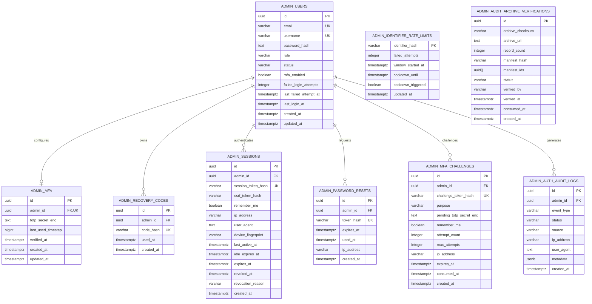

# AUTH-001: Admin Authentication — Final Implementation Blueprint
## Architectural Reconciliation, Cryptographic Specifications, and Swarm Execution Plan

> **Document Status:** FINAL ARCHITECTURAL BLUEPRINT (PLANNING ONLY — PASS 3 READINESS CLOSURE)  
> **Target Milestone:** AUTH-001 Admin Authentication & Session Management  
> **Pillars Covered:** Fastify Backend (`backend/`) ⟷ React/Vite Admin Panel (`Admin_panel/`)  
> **Author & Governance:** Main Orchestrator Agent (Senior Systems Architect & Security Engineer)  
> **Date:** November 2026  
> **Governance:** Zero Code Modifications. Awaiting Explicit Human Approval Before Implementation.

---

## 1. Executive Summary & Architectural Corrections

The approved AUTH-001 specification establishes a zero-trust administrative authentication and session infrastructure for the Parental Control OS Super Admin console.

### Reconciliation of Architectural Decisions:

| Area | Initial Proposal | Corrected Approved Specification | Status | Technical Rationale for Correction |
| :--- | :--- | :--- | :--- | :--- |
| **Session Model** | Stateless Access JWT (15 min) | **Server-Managed Opaque Sessions** | `[CORRECTED]` | JWTs cannot be revoked immediately upon credential compromise, role demotion, or administrative emergency without complex blacklisting. Opaque 256-bit random tokens backed by PostgreSQL allow immediate, server-side session revocation. |
| **Token Storage** | `localStorage` / `sessionStorage` | **HttpOnly, Secure, SameSite Cookies** | `[CORRECTED]` | Web storage is accessible to any JavaScript executing in the origin, exposing tokens to exfiltration via XSS. HttpOnly cookies cannot be read by JavaScript. |
| **MFA Verification** | Client-held temporary JWT | **Server-Stored Ephemeral MFA Challenge** | `[CORRECTED]` | Single-use server challenges (5-minute TTL, bound to `admin_id` and purpose) ensure that password verification alone grants **zero session privileges**. Full session cookies are issued only after TOTP verification succeeds. |
| **CSRF Defense** | Authorization header only | **Double-Submit / Stored CSRF Token + Origin Validation** | `[CORRECTED]` | Cookie-authenticated browsers require defense-in-depth: `SameSite` cookies, strict `Origin`/`Referer` validation, and an `X-CSRF-Token` header verified against the session record. |
| **Super Admin Creation** | `.env` fallback login | **Strict CLI Provisioning Only** (`bin/admin-cli.ts`) | `[CORRECTED]` | Development backdoors in production code present severe security risks. The sole Super Admin must be provisioned via an explicit CLI tool with Argon2id hashing. Zero `.env` login shortcuts. |
| **API Namespace** | `/api/v1/auth/admin` | **`/api/v1/admin/auth/`** | `[CORRECTED]` | Dedicated administrative namespace, cleanly isolating Admin authentication from Parent and Child device endpoints. |

---

## 2. Status Classification Legend

In accordance with strict verification guidelines, all items in this blueprint are classified as:
* **`[VERIFIED]`**: Inspected directly from existing configuration files, package dependencies, or codebase in the active workspace.
* **`[UNVERIFIED — AGENT REPORTED]`**: Configuration setting, environment value, or runtime service reported by an agent or referenced in documentation, but not verified by active live service connection in the current session.
* **`[PROPOSED]`**: Architectural specification designed to satisfy approved AUTH-001 requirements.
* **`[NEEDS DECISION]`**: Open architectural decision requiring human project owner sign-off.

---

## 3. Database Schema Design (Pure PostgreSQL + Drizzle ORM)

All database entities are strictly modeled for PostgreSQL with Drizzle ORM. No migrations will be executed during this planning phase.



---

### Table 1: `admin_users` `[PROPOSED]`
* **Purpose:** Stores administrative identities. Only one Super Admin is initially provisioned via CLI.
* **Columns:**
  * `id`: `uuid` PRIMARY KEY DEFAULT `gen_random_uuid()`.
  * `email`: `varchar(255)` NOT NULL UNIQUE (Normalized lowercase).
  * `username`: `varchar(50)` NOT NULL UNIQUE (Alphanumeric + underscores, lowercase, min 3, max 50).
  * `password_hash`: `text` NOT NULL (Argon2id hash string; created via 12–128 character policy).
  * `role`: `varchar(30)` NOT NULL DEFAULT `'super_admin'` (Only `'super_admin'` allowed in Phase 1).
  * `status`: `varchar(30)` NOT NULL DEFAULT `'active'` (`'active'` | `'suspended'`).
  * `mfa_enabled`: `boolean` NOT NULL DEFAULT `false`.
  * `failed_login_attempts`: `integer` NOT NULL DEFAULT `0` (Diagnostic audit counter for known account).
  * `last_failed_attempt_at`: `timestamp with time zone` NULLABLE.
  * `last_login_at`: `timestamp with time zone` NULLABLE.
  * `created_at`: `timestamp with time zone` NOT NULL DEFAULT `NOW()`.
  * `updated_at`: `timestamp with time zone` NOT NULL DEFAULT `NOW()`.
* **Indexes:**
  * `idx_admin_users_email` ON `(email)`.
  * `idx_admin_users_username` ON `(username)`.

---

### Table 2: `admin_mfa` `[PROPOSED]`
* **Purpose:** Stores encrypted RFC 6238 TOTP secrets and anti-replay state for administrators.
* **Columns:**
  * `id`: `uuid` PRIMARY KEY DEFAULT `gen_random_uuid()`.
  * `admin_id`: `uuid` NOT NULL UNIQUE REFERENCES `admin_users(id)` ON DELETE CASCADE.
  * `totp_secret_enc`: `text` NOT NULL (AES-256-GCM encrypted base32 secret formatted as `v1:iv:tag:cipher`).
  * `last_used_timestep`: `bigint` NULLABLE (PostgreSQL `BIGINT` tracking the matched 30s TOTP timestep counter, preventing replay).
  * `verified_at`: `timestamp with time zone` NULLABLE (Timestamp of successful setup confirmation).
  * `created_at`: `timestamp with time zone` NOT NULL DEFAULT `NOW()`.
  * `updated_at`: `timestamp with time zone` NOT NULL DEFAULT `NOW()`.
* **Sensitive Data Rule:** Raw plaintext TOTP secrets are NEVER stored in the database.

---

### Table 3: `admin_mfa_challenges` `[PROPOSED]`
* **Purpose:** Tracks server-stored, short-lived authentication challenges prior to full session creation and holds pending enrollment secrets.
* **Columns:**
  * `id`: `uuid` PRIMARY KEY DEFAULT `gen_random_uuid()`.
  * `admin_id`: `uuid` NOT NULL REFERENCES `admin_users(id)` ON DELETE CASCADE.
  * `challenge_token_hash`: `varchar(64)` NOT NULL UNIQUE (SHA-256 hash of 256-bit random challenge token).
  * `purpose`: `varchar(30)` NOT NULL (`'admin_login_mfa'` | `'admin_setup_mfa'`).
  * `pending_totp_secret_enc`: `text` NULLABLE (AES-256-GCM encrypted pending TOTP secret for setup challenges; NULL for login challenges).
  * `remember_me`: `boolean` NOT NULL DEFAULT `false` (Transfers login preference to final session).
  * `attempt_count`: `integer` NOT NULL DEFAULT `0` (Tracks failed verification attempts on this challenge).
  * `max_attempts`: `integer` NOT NULL DEFAULT `5` (Exhausts challenge after 5 bad attempts).
  * `ip_address`: `varchar(45)` NOT NULL.
  * `expires_at`: `timestamp with time zone` NOT NULL (Fixed 5-minute expiration from generation).
  * `consumed_at`: `timestamp with time zone` NULLABLE (Atomic consumption timestamp).
  * `created_at`: `timestamp with time zone` NOT NULL DEFAULT `NOW()`.
* **Indexes:**
  * `idx_admin_mfa_challenges_token` ON `(challenge_token_hash)`.
  * `idx_admin_mfa_challenges_admin_active` ON `(admin_id, consumed_at, expires_at)`.

---

### Table 4: `admin_recovery_codes` `[PROPOSED]`
* **Purpose:** 8 single-use emergency backup recovery codes issued upon TOTP enrollment.
* **Columns:**
  * `id`: `uuid` PRIMARY KEY DEFAULT `gen_random_uuid()`.
  * `admin_id`: `uuid` NOT NULL REFERENCES `admin_users(id)` ON DELETE CASCADE.
  * `code_hash`: `varchar(64)` NOT NULL UNIQUE (SHA-256 hash of high-entropy 20-hex character recovery code: `XXXX-XXXX-XXXX-XXXX-XXXX`, representing 80 bits of cryptographic entropy).
  * `used_at`: `timestamp with time zone` NULLABLE (Timestamp when consumed; must be NULL to be valid).
  * `created_at`: `timestamp with time zone` NOT NULL DEFAULT `NOW()`.
* **Indexes:**
  * `idx_admin_recovery_codes_lookup` ON `(admin_id, code_hash)`.

---

### Table 5: `admin_identifier_rate_limits` `[PROPOSED]`
* **Purpose:** Keyed HMAC rate limiting with fixed-window counters and cooldowns for both existing and nonexistent identifiers, decoupling throttling from the `admin_users` table and preventing attacker-induced DoS lockouts.
* **Columns:**
  * `identifier_hash`: `varchar(67)` PRIMARY KEY (Holds 3-character version prefix `k1:` plus 64-hex-character HMAC-SHA-256: `k1:<hmac_hex>`).
  * `failed_attempts`: `integer` NOT NULL DEFAULT 1.
  * `window_started_at`: `timestamp with time zone` NOT NULL DEFAULT `NOW()`.
  * `cooldown_until`: `timestamp with time zone` NULLABLE.
  * `cooldown_triggered`: `boolean` NOT NULL DEFAULT `false` (Evaluated and set to true atomically during upsert when the 10th failed attempt triggers a new cooldown; false during pre-existing active cooldown or normal failure counts).
  * `updated_at`: `timestamp with time zone` NOT NULL DEFAULT `NOW()`.
* **Indexes:**
  * `idx_admin_rate_limits_cooldown` ON `(cooldown_until)`.

---

### Table 6: `admin_sessions` `[PROPOSED]`
* **Purpose:** Tracks active server-managed sessions. Replaces all JWT usage in Admin.
* **Columns:**
  * `id`: `uuid` PRIMARY KEY DEFAULT `gen_random_uuid()`.
  * `admin_id`: `uuid` NOT NULL REFERENCES `admin_users(id)` ON DELETE CASCADE.
  * `session_token_hash`: `varchar(64)` NOT NULL UNIQUE (SHA-256 hash of 256-bit opaque session token).
  * `csrf_token_hash`: `varchar(64)` NOT NULL (SHA-256 hash of the CSRF secret).
  * `remember_me`: `boolean` NOT NULL DEFAULT `false`.
  * `ip_address`: `varchar(45)` NOT NULL (IPv4 or IPv6 string).
  * `user_agent`: `text` NOT NULL.
  * `device_fingerprint`: `varchar(64)` NULLABLE (Optional best-effort diagnostic hash).
  * `last_active_at`: `timestamp with time zone` NOT NULL DEFAULT `NOW()`.
  * `idle_expires_at`: `timestamp with time zone` NOT NULL (Sliding: `last_active_at + 30m` or `7d`, capped at `expires_at`).
  * `expires_at`: `timestamp with time zone` NOT NULL (Absolute expiration: strictly 7 days from creation).
  * `revoked_at`: `timestamp with time zone` NULLABLE (Explicit revocation timestamp).
  * `revocation_reason`: `varchar(100)` NULLABLE (`'user_logout'`, `'admin_forced'`, `'password_reset'`, `'password_change'`, `'theft_detected'`).
  * `created_at`: `timestamp with time zone` NOT NULL DEFAULT `NOW()`.
* **Indexes:**
  * `idx_admin_sessions_token_hash` ON `(session_token_hash)`.
  * `idx_admin_sessions_admin_active` ON `(admin_id, revoked_at, expires_at, idle_expires_at)`.

---

### Table 7: `admin_password_resets` `[PROPOSED]`
* **Purpose:** Single-use password recovery tokens requested via email.
* **Columns:**
  * `id`: `uuid` PRIMARY KEY DEFAULT `gen_random_uuid()`.
  * `admin_id`: `uuid` NOT NULL REFERENCES `admin_users(id)` ON DELETE CASCADE.
  * `token_hash`: `varchar(64)` NOT NULL UNIQUE (SHA-256 of 256-bit random reset token).
  * `expires_at`: `timestamp with time zone` NOT NULL (15 minutes from generation).
  * `used_at`: `timestamp with time zone` NULLABLE.
  * `ip_address`: `varchar(45)` NOT NULL.
  * `created_at`: `timestamp with time zone` NOT NULL DEFAULT `NOW()`.
* **Indexes:**
  * `idx_admin_password_resets_token` ON `(token_hash)`.

---

### Table 8: `admin_auth_audit_logs` `[PROPOSED]`
* **Purpose:** Append-only immutable security ledger for administrative authentication events.
* **Columns:**
  * `id`: `uuid` PRIMARY KEY DEFAULT `gen_random_uuid()`.
  * `admin_id`: `uuid` NULLABLE REFERENCES `admin_users(id)` ON DELETE SET NULL.
  * `event_type`: `varchar(50)` NOT NULL (Strict catalog of 22 documented events listed below).
  * `status`: `varchar(20)` NOT NULL (`'SUCCESS'`, `'FAILURE'`).
  * `source`: `varchar(20)` NOT NULL DEFAULT `'WEB'` (`'WEB'` | `'CLI'` | `'SYSTEM'`).
  * `ip_address`: `varchar(45)` NULLABLE (Recorded for `'WEB'` events; NULL for `'CLI'` and `'SYSTEM'` events).
  * `user_agent`: `text` NULLABLE (Recorded for `'WEB'` events; NULL for `'CLI'` and `'SYSTEM'` events).
  * `metadata`: `jsonb` NULLABLE (Contains non-sensitive event context, e.g. CLI caller uid, node version, or failure reason).
  * `created_at`: `timestamp with time zone` NOT NULL DEFAULT `NOW()`.
* **Database Permissions Rule:** Application runtime role `parental_admin` has `INSERT` and `SELECT` only; `UPDATE`, `DELETE`, and `TRUNCATE` are revoked.

---

### Table 9: `admin_audit_archive_verifications` `[PROPOSED]`
* **Purpose:** Stores cryptographically verified archive receipts established by an independent attestation service prior to audit record pruning. Binds the verified archive to the exact, canonical set of audit record IDs to prevent unauthorized deletions or record substitution.
* **Columns:**
  * `id`: `uuid` PRIMARY KEY DEFAULT `gen_random_uuid()`.
  * `archive_checksum`: `varchar(64)` NOT NULL (SHA-256 hash of verified immutable archive bundle).
  * `archive_uri`: `text` NOT NULL (Location in immutable WORM storage, e.g. `s3://parental-audit-worm/...`).
  * `record_count`: `integer` NOT NULL (Exact number of records verified in archive bundle).
  * `manifest_hash`: `varchar(64)` NOT NULL (SHA-256 hash of canonical sorted, newline-delimited lowercase UUID strings of all records in the archive).
  * `manifest_ids`: `uuid[]` NOT NULL (Canonical ascending sorted array of exact audit record IDs verified in the archive bundle).
  * `status`: `varchar(32)` NOT NULL DEFAULT `'VERIFIED'` (`'VERIFIED'`, `'CONSUMED'`).
  * `verified_by`: `varchar(100)` NOT NULL (Attestation identity, e.g. `'worm_attestation_service'`).
  * `verified_at`: `timestamp with time zone` NOT NULL DEFAULT `NOW()`.
  * `consumed_at`: `timestamp with time zone` NULLABLE.
  * `created_at`: `timestamp with time zone` NOT NULL DEFAULT `NOW()`.
* **Indexes:**
  * `idx_audit_verifications_status` ON `(status, consumed_at)`.
* **Database Permissions Rule:** Archival runner `parental_audit_archive` has `SELECT` only; cannot `INSERT`, `UPDATE`, or `DELETE`. Only the dedicated attestation service can insert verification records. Function owner `parental_audit_pruner` can update `consumed_at`.

---

### Complete Reconciled Audit Event Catalog (22 Events):
Every audit event emitted across all documented workflows is defined here:
1. `LOGIN_PASSWORD_SUCCESS`: Password step passed; challenge issued.
2. `LOGIN_PASSWORD_FAILURE`: Invalid password or nonexistent identifier.
3. `LOGIN_COOLDOWN_TRIGGERED`: Identifier reached 10 failures in 15 min; 60s cooldown applied.
4. `MFA_CHALLENGE_ISSUED`: Ephemeral 5-minute MFA challenge generated.
5. `MFA_VERIFY_SUCCESS`: Valid TOTP code provided; session created.
6. `MFA_VERIFY_FAILURE`: Invalid TOTP code or exhausted challenge.
7. `MFA_ENROLL_STARTED`: Setup challenge validated; pending TOTP secret generated.
8. `MFA_CONFIRM_SUCCESS`: Initial TOTP verified; MFA activated; 8 recovery codes generated.
9. `MFA_CONFIRM_FAILURE`: Confirmation TOTP code invalid or mismatch.
10. `MFA_RECOVERY_USED`: Single-use 80-bit recovery code successfully consumed.
11. `MFA_RECOVERY_FAILURE`: Invalid or already used recovery code submitted.
12. `RECOVERY_CODES_REGENERATED`: Prior codes invalidated; 8 new recovery codes issued.
13. `LOGOUT`: Current session explicitly revoked.
14. `LOGOUT_ALL`: All active sessions for administrator explicitly revoked.
15. `SESSION_REVOKED`: Specific session revoked via admin session management.
16. `PASSWORD_RESET_REQUESTED`: Password reset token created and dispatched via email/Mailpit.
17. `PASSWORD_RESET_COMPLETED`: Reset token consumed atomically; password updated; all sessions revoked.
18. `PASSWORD_CHANGED`: Current password verified; password updated; sessions rotated.
19. `CLI_ADMIN_PROVISIONED`: Root Super Admin created via `admin-cli.ts provision`.
20. `CLI_PASSWORD_RESET`: Password reset executed via `admin-cli.ts reset-password`.
21. `CLI_MFA_RESET`: MFA reset and sessions wiped via `admin-cli.ts reset-mfa`.
22. `CLI_COOLDOWN_CLEARED`: Identifier throttling cooldown wiped via `admin-cli.ts clear-cooldown`.

---

## 4. Consistent Policies Across All Modules

### 4.1 Login Input Validation vs Password Creation Policy `[PROPOSED]`
A strict separation is enforced between **password creation** (strict security bounds) and **login validation** (bounded schema defense):

1. **Password Creation Policy (New Passwords):**
   * **Applies To:** Initial CLI provisioning, `POST change-password` (`newPassword`), and `POST reset-password` (`newPassword`).
   * **Length Requirement:** Minimum **12 characters**, Maximum **128 characters**.
   * **Character Set Policy (NIST SP 800-63B Aligned):** No mandatory arbitrary character composition rules (no mandatory combination of uppercase, lowercase, digits, and symbols). Passphrases and unicode characters are fully supported.
   * **Common Password Check:** Reject passwords matching user's email, username, or trivial sequences (e.g. `123456789012`, `password1234`).
2. **Login Input Validation (`POST login`):**
   * **Applies To:** Incoming login requests.
   * **Schema Bounds:**
     * `identifier`: `z.string().min(3).max(255).trim()`
     * `password`: `z.string().min(1).max(128)`
   * **Security Rationale:** Bounded to 128 characters to protect against algorithmic DoS (preventing an attacker from sending megabytes of text to exhaust server CPU on Argon2id hashing). Does **not** reject passwords under 12 characters at the schema layer to avoid leaking policy rules or breaking potential historical credentials.

### 4.2 Reconciled Session Expiration & Persistence Policy `[PROPOSED]`
All components (database, API, cookie attributes, middleware, and tests) adhere to these rules:
* **Remember Unchecked (`rememberMe: false`):**
  * `idle_expires_at`: `last_active_at + 30 minutes`.
  * Cookie `Max-Age`: Omitted (Standard session cookie discarded upon browser exit) OR set to `1800` seconds. Server strictly enforces 30-minute idle expiration.
* **Remember Checked (`rememberMe: true`):**
  * `idle_expires_at`: `last_active_at + 7 days` (capped at absolute expiration).
  * Cookie `Max-Age`: `604800` (7 days in seconds).
* **Absolute Session Expiration (Both Cases):**
  * `expires_at`: Strictly **7 days from session creation**. No session may persist past this timestamp under any circumstances.
* **MFA Isolation:**
  * The `rememberMe` checkbox **ONLY** alters idle session persistence.
  * Every new login attempt on any browser or device **strictly requires both Password + TOTP**. There is **ZERO trusted-device MFA bypass**.

### 4.3 Account Status & Suspended-Account Rejection Policy `[PROPOSED]`
* **Strict Active Status Requirement:** The authentication pipeline strictly requires `admin_users.status = 'active'`.
* **Suspended / Inactive Account Handling (`status !== 'active'`):**
  If an administrator account is identified during `POST /login` with a status of `'suspended'` (or any status other than `'active'`):
  1. **Timing Attack Mitigation:** To prevent user status enumeration or account probing, the server immediately executes a dummy Argon2id password verification (`argon2.verify(DUMMY_ARGON2_HASH, password)`) consuming identical computational time as an active account check.
  2. **Zero Challenge Issuance:** Absolutely **NO** MFA challenge (`admin_login_mfa` or `admin_setup_mfa`) is created or issued.
  3. **Zero Session / Cookie Issuance:** Absolutely **NO** session record is created in `admin_sessions`, and no `admin_session` cookie is sent.
  4. **Audit Logging:** An audit event `LOGIN_PASSWORD_FAILURE` is recorded with structured metadata: `{ "reason": "account_suspended", "identifier_hash": hmacHash }`.
  5. **Generic Error Response:** Returns generic HTTP 401 Unauthorized:
     ```json
     {
       "statusCode": 401,
       "error": "Unauthorized",
       "message": "Invalid credentials"
     }
     ```
* **Nonexistent Identifier Handling:**
  If no administrator matches the normalized identifier:
  1. The server executes the same dummy Argon2id password verification.
  2. Records audit event `LOGIN_PASSWORD_FAILURE` with metadata `{ "reason": "user_not_found", "identifier_hash": hmacHash }`.
  3. Increments the identifier rate limit counter.
  4. Returns the exact same generic HTTP 401 Unauthorized response.

### 4.4 First-Time MFA Setup Challenge Creation & Purpose Enforcement `[PROPOSED]`
When an administrator logs in with valid credentials, `admin_users.status === 'active'`, and `admin_users.mfa_enabled === false`:
1. **Setup Challenge Creation Flow:**
   * Server generates a 256-bit cryptographically secure random token (`crypto.randomBytes(32).toString('hex')`).
   * Server inserts a new challenge record into `admin_mfa_challenges`:
     * `id`: `gen_random_uuid()`
     * `admin_id`: `user.id`
     * `challenge_token_hash`: `sha256(rawChallengeToken)`
     * `purpose`: `'admin_setup_mfa'`
     * `pending_totp_secret_enc`: `NULL` (populated during enrollment)
     * `remember_me`: Boolean preference from login payload
     * `attempt_count`: `0`
     * `max_attempts`: `5`
     * `ip_address`: `req.ip`
     * `expires_at`: `NOW() + INTERVAL '5 minutes'`
     * `consumed_at`: `NULL`
   * Audit event logged: `MFA_CHALLENGE_ISSUED` with `{ "purpose": "admin_setup_mfa" }`.
   * Server returns HTTP 200:
     ```json
     {
       "requiresMfaSetup": true,
       "challengeToken": "cf93a8b417e2e4..."
     }
     ```
   * **Zero Session Issued:** The browser receives **NO session cookie**.
2. **Strict Purpose Isolation:**
   * `/mfa/verify` and `/mfa/recovery` **strictly require** `purpose === 'admin_login_mfa'`.
   * `/mfa/enroll` and `/mfa/confirm` **strictly require** `purpose === 'admin_setup_mfa'`.
   * Cross-purpose execution is strictly rejected with `401 Unauthorized`.

### 4.5 Atomic Challenge Consumption & Atomic Attempt Counters `[PROPOSED]`
In all three challenge verification flows (`/mfa/verify`, `/mfa/confirm`, and `/mfa/recovery`):

1. **Atomic Failed Attempt Increment (Pre-Verification Failure):**
   When submitted TOTP or recovery code is invalid, the challenge is **NOT** consumed. Instead, failed attempts are incremented conditionally and atomically:
   ```sql
   UPDATE admin_mfa_challenges 
   SET attempt_count = attempt_count + 1 
   WHERE id = :challengeId 
     AND consumed_at IS NULL 
     AND expires_at > NOW() 
     AND purpose = :expectedPurpose 
     AND attempt_count < max_attempts 
   RETURNING attempt_count, max_attempts;
   ```
   * If 0 rows are returned (due to concurrent race condition or challenge already expired/exhausted), the request is rejected as challenge exhausted.
   * If returned `attempt_count >= max_attempts`, the challenge is exhausted, security event is logged, and HTTP 401 is returned.
2. **Atomic Challenge Consumption (Post-Verification Success):**
   When the cryptographic factor is verified, the challenge is consumed atomically:
   ```sql
   UPDATE admin_mfa_challenges 
   SET consumed_at = NOW() 
   WHERE id = :challengeId 
     AND consumed_at IS NULL 
     AND expires_at > NOW() 
     AND purpose = :expectedPurpose 
     AND attempt_count < max_attempts 
   RETURNING id;
   ```
   * If 0 rows are returned (because the challenge was consumed in parallel by a concurrent replay or expired), the transaction rolls back immediately and returns HTTP 401.

### 4.6 Pending MFA Enrollment Secret & Recovery Code Entropy `[PROPOSED]`
1. **Enrollment Phase (`POST /mfa/enroll`):**
   * Validates setup challenge token (`purpose === 'admin_setup_mfa'`).
   * Generates new base32 secret and `otpauth://` URI.
   * Encrypts pending secret via AES-256-GCM (`v1:iv:tag:cipher`) and updates `admin_mfa_challenges.pending_totp_secret_enc` for this setup challenge:
     ```sql
     UPDATE admin_mfa_challenges
     SET pending_totp_secret_enc = :encryptedSecret
     WHERE id = :challengeId 
       AND consumed_at IS NULL 
       AND expires_at > NOW() 
       AND purpose = 'admin_setup_mfa';
     ```
   * Logs `MFA_ENROLL_STARTED`.
   * Returns **ONLY** `{ totpSecret, otpauthUri }`.
   * **Recovery codes are NOT generated or activated at this stage.**
2. **Confirmation Phase (`POST /mfa/confirm`):**
   * Accepts `{ challengeToken, totpCode }` (`purpose === 'admin_setup_mfa'`).
   * Decrypts `challenge.pending_totp_secret_enc`.
   * Verifies TOTP code against pending secret. If invalid, increments attempt count atomically and logs `MFA_CONFIRM_FAILURE`.
   * Inside **ONE single PostgreSQL transaction (`db.transaction`)**:
     1. Atomically consumes setup challenge (`consumed_at = NOW()`).
     2. Inserts or updates `admin_mfa` (storing the verified secret in `totp_secret_enc` and initializing `last_used_timestep = matchedTimestep`).
     3. Updates `admin_users.mfa_enabled = true`.
     4. **Generates 8 high-entropy recovery codes preserving full 80-bit entropy:**
        * Each code is generated from 10 cryptographically secure bytes (`crypto.randomBytes(10)`).
        * Represented as **20 hexadecimal characters** grouped into five groups of four: `XXXX-XXXX-XXXX-XXXX-XXXX` (e.g. `a1b2-c3d4-e5f6-7890-abcd`).
        * Calculation: $20 \text{ hex chars} \times 4 \text{ bits/char} = \mathbf{80 \text{ bits of cryptographic entropy}}$.
        * Hashes each code via SHA-256 and inserts the hashes into `admin_recovery_codes`.
     5. Inserts session into `admin_sessions`.
     6. Inserts audit log `'MFA_CONFIRM_SUCCESS'`.
   * Issues session cookie and CSRF token.
   * Returns `{ user, csrfToken, recoveryCodes: [plaintextCodes] }`.
   * **Plaintext recovery codes are presented to the administrator ONLY ONCE.**
3. **Atomic Recovery Consumption & Failure Protocol (`POST /mfa/recovery`):**
   * Validates login challenge token (`purpose === 'admin_login_mfa'`).
   * Accepts recovery code in format `XXXX-XXXX-XXXX-XXXX-XXXX` (case-insensitive, hyphens optional in input).
   * Computes SHA-256 of normalized recovery code.
   * Inside **ONE single PostgreSQL transaction (`db.transaction`)**:
     1. **Atomic Recovery Code Consumption:**
        ```sql
        UPDATE admin_recovery_codes 
        SET used_at = NOW() 
        WHERE admin_id = :adminId AND code_hash = :codeHash AND used_at IS NULL 
        RETURNING id;
        ```
        *(If 0 rows returned, rollback transaction and increment challenge attempt counter outside).*
     2. **Atomic Challenge Consumption:**
        ```sql
        UPDATE admin_mfa_challenges 
        SET consumed_at = NOW() 
        WHERE id = :challengeId 
          AND consumed_at IS NULL 
          AND expires_at > NOW() 
          AND purpose = 'admin_login_mfa' 
          AND attempt_count < max_attempts 
        RETURNING id;
        ```
        *(If 0 rows returned, rollback transaction — prevents two concurrent requests using different recovery codes from consuming the same challenge).*
     3. **Insert Session:**
        `INSERT INTO admin_sessions ...`
     4. **Insert Audit Log:**
        `INSERT INTO admin_auth_audit_logs (admin_id, event_type, status, source, ip_address, user_agent) VALUES (:adminId, 'MFA_RECOVERY_USED', 'SUCCESS', 'WEB', :ip, :ua)`
   * If any step fails, entire transaction rolls back.

### 4.7 Atomic Recovery Code Regeneration Workflow `[PROPOSED]`
* **Endpoint:** `POST /api/v1/admin/auth/mfa/recovery/regenerate`
* **Required Reauthentication:**
  * Active session cookie + matching `X-CSRF-Token` header.
  * Re-verification of current `password`.
  * Re-verification of current `totpCode`.
* **Execution (Single Transaction):**
  1. Verifies password with Argon2id.
  2. Verifies TOTP code against decrypted `admin_mfa.totp_secret_enc` and calculates `matchedTimestep`.
  3. Inside **ONE single PostgreSQL transaction (`db.transaction`)**:
     * **Atomic Replay Check & Timestep Update:**
       ```sql
       UPDATE admin_mfa
       SET last_used_timestep = :matchedTimestep
       WHERE admin_id = :adminId
         AND (
           last_used_timestep IS NULL
           OR last_used_timestep < :matchedTimestep
         )
       RETURNING id;
       ```
       *(If exactly 1 row is not returned, rollback and reject with 401 — timestep already consumed).*
     * Deletes or marks `used_at = NOW()` on all existing recovery codes in `admin_recovery_codes` for this admin.
     * Generates 8 new 20-hex character recovery codes (80-bit entropy each).
     * Hashes each code with SHA-256 and inserts into `admin_recovery_codes`.
     * Inserts audit log `'RECOVERY_CODES_REGENERATED'`.
* **Rate Limiting:** Max 3 regeneration requests per hour per admin.
* **Response:** Returns `{ success: true, recoveryCodes: [newPlaintextCodes] }` for one-time display.

### 4.8 Reconciled Fixed-Window Rate Limiting & Cooldown Algorithm `[PROPOSED]`
To ensure equivalent semantics across Redis and PostgreSQL fallback without risking attacker-induced permanent lockouts:

1. **Algorithm Definition:** **15-Minute Fixed-Window Rate Limiting with 60-Second Cooldown**
   * Window duration: 15 minutes (`900 seconds`).
   * Cooldown duration: 60 seconds.
   * Maximum failed attempts before cooldown: 10 attempts.
   * *Progressive Delay Clarification:* Variable progressive delay schedules and client tarpitting are explicitly excluded in favor of deterministic fixed-window throttling with 60-second cooldown windows.
2. **Identifier Normalization & Keyed HMAC:**
   * **Normalization (`normalize(identifier)`):**
     * Trim whitespace: `identifier.trim()`.
     * If contains `@`: lowercase domain and local-part: `identifier.trim().toLowerCase()`.
     * If username (no `@`): strip leading `@`, lowercase: `identifier.trim().replace(/^@/, '').toLowerCase()`.
   * **Key Decoding:** Environment secret `IDENTIFIER_RATE_LIMIT_KEY` is a 64-character hexadecimal string representing 32 bytes of raw entropy. It is decoded via `Buffer.from(env.IDENTIFIER_RATE_LIMIT_KEY, 'hex')` before being passed to `crypto.createHmac`.
   * **Key Versioning:** Stored as `'k1:' + hmacHex` (stored in `varchar(67)` column).
3. **Redis Implementation (Atomic Lua Script):**
   Executed atomically in Redis to avoid race conditions:
   ```lua
   -- KEYS[1]: rl:id:{hash}:window
   -- KEYS[2]: rl:id:{hash}:cooldown
   -- ARGV[1]: window_ttl (900)
   -- ARGV[2]: cooldown_duration (60)
   -- ARGV[3]: max_failures (10)
   local in_cooldown = redis.call('EXISTS', KEYS[2])
   if in_cooldown == 1 then
       local ttl = redis.call('TTL', KEYS[2])
       return { -1, 1, ttl } -- Cooldown active; do not extend cooldown!
   end
   local count = redis.call('INCR', KEYS[1])
   if count == 1 then
       redis.call('EXPIRE', KEYS[1], ARGV[1])
   end
   if count >= tonumber(ARGV[3]) then
       redis.call('SETEX', KEYS[2], ARGV[2], 1)
       return { count, 1, tonumber(ARGV[2]) } -- Trigger cooldown
   end
   local ttl = redis.call('TTL', KEYS[1])
   return { count, 0, ttl }
   ```
4. **PostgreSQL Fallback Implementation (Durable Rate Limits):**
   Reproduces the exact same fixed-window semantics when Redis is unavailable:
   ```sql
   INSERT INTO admin_identifier_rate_limits (
     identifier_hash, 
     failed_attempts, 
     window_started_at, 
     cooldown_until, 
     cooldown_triggered, 
     updated_at
   )
   VALUES (:identifierHash, 1, NOW(), NULL, false, NOW())
   ON CONFLICT (identifier_hash) DO UPDATE
   SET 
     failed_attempts = CASE 
       -- 1. Active cooldown: DO NOT increment attempts, freeze counter
       WHEN admin_identifier_rate_limits.cooldown_until IS NOT NULL AND admin_identifier_rate_limits.cooldown_until > NOW() 
         THEN admin_identifier_rate_limits.failed_attempts
       -- 2. Window expired: reset window counter to 1
       WHEN admin_identifier_rate_limits.window_started_at + INTERVAL '15 minutes' < NOW() 
         THEN 1 
       -- 3. Within window: increment counter
       ELSE admin_identifier_rate_limits.failed_attempts + 1 
     END,
     window_started_at = CASE 
       -- 1. Active cooldown: preserve existing window_started_at
       WHEN admin_identifier_rate_limits.cooldown_until IS NOT NULL AND admin_identifier_rate_limits.cooldown_until > NOW() 
         THEN admin_identifier_rate_limits.window_started_at
       -- 2. Window expired: reset to NOW()
       WHEN admin_identifier_rate_limits.window_started_at + INTERVAL '15 minutes' < NOW() 
         THEN NOW() 
       -- 3. Within window: preserve existing window_started_at
       ELSE admin_identifier_rate_limits.window_started_at 
     END,
     cooldown_until = CASE 
       -- 1. Active cooldown: DO NOT extend cooldown! Preserve existing cooldown_until
       WHEN admin_identifier_rate_limits.cooldown_until IS NOT NULL AND admin_identifier_rate_limits.cooldown_until > NOW() 
         THEN admin_identifier_rate_limits.cooldown_until
       -- 2. Threshold reached (10th failure): trigger 60-second cooldown
       WHEN (CASE 
               WHEN admin_identifier_rate_limits.window_started_at + INTERVAL '15 minutes' < NOW() THEN 1 
               ELSE admin_identifier_rate_limits.failed_attempts + 1 
             END) >= 10 
         THEN NOW() + INTERVAL '60 seconds'
       -- 3. Otherwise: clear expired cooldown or keep NULL
       ELSE NULL
     END,
     cooldown_triggered = CASE 
       -- Newly triggered if threshold reached and was NOT already in an active cooldown
       WHEN (admin_identifier_rate_limits.cooldown_until IS NULL OR admin_identifier_rate_limits.cooldown_until <= NOW())
         AND (CASE 
                WHEN admin_identifier_rate_limits.window_started_at + INTERVAL '15 minutes' < NOW() THEN 1 
                ELSE admin_identifier_rate_limits.failed_attempts + 1 
              END) >= 10 
         THEN true 
       ELSE false 
     END,
     updated_at = NOW()
   RETURNING 
     failed_attempts, 
     cooldown_until,
     cooldown_triggered,
     (cooldown_until IS NOT NULL AND cooldown_until > NOW() AND NOT cooldown_triggered) AS was_already_in_cooldown,
     CASE 
       WHEN cooldown_until IS NOT NULL AND cooldown_until > NOW() 
         THEN GREATEST(1, CEIL(EXTRACT(EPOCH FROM (cooldown_until - NOW()))))::integer 
       ELSE 0 
     END AS retry_after_seconds;
   ```
   * **Atomic Semantic Equivalence to Redis & Application Evaluation:**
     The application executes this upsert and inspects `cooldown_triggered` (boolean), `was_already_in_cooldown` (boolean), and `retry_after_seconds` (integer):
     1. **Newly Triggered Cooldown (`cooldown_triggered === true`):**
        This exact request represents the 10th failed attempt. The database atomically set `cooldown_until = NOW() + 60s`. The application logs audit event `LOGIN_COOLDOWN_TRIGGERED` and returns HTTP 429 with header `Retry-After: 60`.
        *(Semantically identical to Redis returning `{ 10, 1, 60 }`).*
     2. **Pre-Existing Active Cooldown (`was_already_in_cooldown === true`):**
        The identifier was already in an active cooldown prior to this request (`cooldown_until > NOW()` before execution). Crucially, `failed_attempts` was NOT incremented, `window_started_at` was NOT altered, and `cooldown_until` was NOT extended. The application immediately rejects the request with HTTP 429 and header `Retry-After: ${retry_after_seconds}`.
        *(Semantically identical to Redis returning `{ -1, 1, ttl }`).*
     3. **Normal Failed Attempt (`cooldown_triggered === false && was_already_in_cooldown === false`):**
        The failure counter was incremented within the current 15-minute window (`failed_attempts < 10`). No cooldown is active. The application proceeds with authentication failure handling and returns HTTP 401 (`Invalid credentials`).
        *(Semantically identical to Redis returning `{ count, 0, ttl }`).*
5. **State Reset on Successful Password Verification:**
   * Resets identifier state across **both** stores:
     ```typescript
     try {
       await redis.del(`rl:id:${hash}:window`, `rl:id:${hash}:cooldown`);
     } catch (err) {
       logger.warn({ err }, 'Redis rate limit reset failed, proceeding to DB reset');
     }
     await db.delete(adminIdentifierRateLimits).where(eq(adminIdentifierRateLimits.identifierHash, hash));
     ```
   * If Redis is unreachable during reset, the PostgreSQL reset still executes; Redis keys expire naturally via their 900s TTL.
6. **Production Fail-Closed Policy:** In production, if Redis is unavailable, the system fails over directly to PostgreSQL `admin_identifier_rate_limits`. **No silent in-memory fallback in production.**

---

## 5. Final API Contract (`/api/v1/admin/auth/`)

### Cookie Specifications `[PROPOSED]`:
* **Name:** `admin_session`
* **Attributes:**
  * `HttpOnly: true` (Strictly inaccessible to client-side scripts).
  * `Secure: true` in production (`false` only when `NODE_ENV === 'development'` on localhost).
  * `SameSite: 'Strict'` (In same-site reverse proxy deployment) or `'Lax'` (in approved cross-origin deployment).
  * `Path: '/api/v1/admin'` (Scoped strictly to administrative endpoints).
  * `Max-Age: 604800` (If `remember_me: true`) or omitted / session-length (if `remember_me: false`).

### CSRF & Origin Validation Standard `[PROPOSED]`:
* For every created session, a 256-bit cryptographically random `csrf_token` is generated.
* The server sends `csrf_token` in the JSON response of `/mfa/verify`, `/mfa/confirm`, `/mfa/recovery`, `/change-password`, and `GET /me`.
* The Admin UI stores `csrf_token` in memory (Zustand store).
* Every mutating HTTP request (`POST`, `PUT`, `PATCH`, `DELETE`) to `/api/v1/admin/*` must include header `X-CSRF-Token: <csrf_token>`.
* The server computes `sha256(headerToken)` and compares it against `session.csrf_token_hash`.
* **Origin Header Check:** For all state-changing requests, the server validates that `req.headers.origin` (or `referer`) matches the configured administrative frontend origin.

---

### Endpoint Specifications:

#### 1. `POST /api/v1/admin/auth/login` `[PROPOSED]`
* **Auth Required:** None (Rate limited: 10 req/min per IP; identifier-based 15-minute window with 60-second cooldown upon 10 failures).
* **Request Body:**
  ```typescript
  {
    identifier: string; // Valid email OR alphanumeric username (min 3, max 255)
    password: string;   // Min 1, max 128 characters (bounded schema protection)
    rememberMe?: boolean; // Default false
  }
  ```
* **Execution Flow:**
  1. Computes keyed HMAC identifier hash and checks rate limit store (Redis Lua / PostgreSQL fallback). If an active cooldown is already present (`was_already_in_cooldown === true` / Redis `{ -1, 1, ttl }`), rejects immediately with HTTP 429 (`Retry-After: <seconds>`) without incrementing failure counters or extending the cooldown.
  2. Looks up account in `admin_users` by normalized email or username.
  3. **Strict Account Status & Timing Defense:**
     * If user is not found **OR** `admin_users.status !== 'active'` (e.g. `'suspended'`):
       * Executes dummy Argon2id hash verification (`argon2.verify(DUMMY_ARGON2_HASH, password)`) to eliminate timing differentials and user-enumeration leaks.
       * Increments identifier rate limit failure counter via rate limit store.
       * If this attempt triggers a new cooldown (`cooldown_triggered === true` / Redis `{ 10, 1, 60 }`), logs audit event `LOGIN_COOLDOWN_TRIGGERED` and returns HTTP 429 (`Retry-After: 60`).
       * Otherwise, logs audit event `LOGIN_PASSWORD_FAILURE` with metadata `{ "reason": user ? "account_suspended" : "user_not_found", "identifier_hash": hmacHash }` and rejects with generic HTTP 401: `{ "statusCode": 401, "error": "Unauthorized", "message": "Invalid credentials" }`.
       * **Zero MFA Challenge:** No challenge token is generated or returned.
       * **Zero Session:** No session record is created; no cookie is set.
  4. If user exists and `admin_users.status === 'active'`:
     * Verifies password against `admin_users.password_hash` using Argon2id.
     * If invalid: increments rate limit failure counter. If this attempt triggers a new cooldown (`cooldown_triggered === true` / Redis `{ 10, 1, 60 }`), logs audit event `LOGIN_COOLDOWN_TRIGGERED` and returns HTTP 429 (`Retry-After: 60`). Otherwise, logs `LOGIN_PASSWORD_FAILURE` and returns generic HTTP 401.
     * If valid: resets identifier rate limits in Redis and PostgreSQL.
  5. **MFA Challenge Dispatch:**
     * If `admin_users.mfa_enabled === true`: creates `admin_login_mfa` challenge, logs `MFA_CHALLENGE_ISSUED`, returns `requiresMfa: true`.
     * If `admin_users.mfa_enabled === false`: creates `admin_setup_mfa` challenge, logs `MFA_CHALLENGE_ISSUED`, returns `requiresMfaSetup: true`.
* **Success Response (MFA Enabled):** `200 OK`
  ```json
  {
    "requiresMfa": true,
    "challengeToken": "cf93a8b417e2e4...",
    "mfaType": "totp"
  }
  ```
* **Success Response (MFA Setup Required):** `200 OK`
  ```json
  {
    "requiresMfaSetup": true,
    "challengeToken": "cf93a8b417e2e4..."
  }
  ```
* **Error Responses:**
  * `400 Bad Request`: Validation error.
  * `401 Unauthorized`: `{ "statusCode": 401, "error": "Unauthorized", "message": "Invalid credentials" }` (Identical response for bad password, nonexistent user, or suspended account).
  * `429 Too Many Requests`: 60-second cooldown active or IP rate limit reached (`Retry-After: <seconds>`).

#### 2. `POST /api/v1/admin/auth/mfa/verify` `[PROPOSED]`
* **Auth Required:** Valid `challengeToken` (`purpose === 'admin_login_mfa'`, max 5 attempts).
* **Request Body:**
  ```typescript
  {
    challengeToken: string;
    totpCode: string; // Exactly 6 digits
  }
  ```
* **Transaction Execution:** Executed inside a single PostgreSQL transaction (Challenge consumed + TOTP timestep updated + session created + audit log).
* **Set-Cookie Header:**
  `admin_session=<opaque_token>; Path=/api/v1/admin; HttpOnly; SameSite=Strict; [Max-Age=604800 if rememberMe]`
* **Success Response:** `200 OK`
  ```json
  {
    "user": {
      "id": "e3b0c442-98fc-1c14-9afb-4c8996fb9242",
      "email": "admin@parentalcontrol.local",
      "username": "superadmin",
      "role": "super_admin"
    },
    "csrfToken": "a4f8d9b2...",
    "expiresAt": "2026-11-26T07:23:22.000Z"
  }
  ```

#### 3. `POST /api/v1/admin/auth/mfa/enroll` `[PROPOSED]`
* **Auth Required:** Valid setup `challengeToken` (`purpose === 'admin_setup_mfa'`).
* **Request Body:** `{ challengeToken: string; }`
* **Behavior:** Generates secret, encrypts with AES-256-GCM, stores in `admin_mfa_challenges.pending_totp_secret_enc`. Logs `MFA_ENROLL_STARTED`.
* **Success Response:** `200 OK`
  ```json
  {
    "totpSecret": "JBSWY3DPEHPK3PXP",
    "otpauthUri": "otpauth://totp/ParentalControlAdmin:admin@parentalcontrol.local?secret=JBSWY3DPEHPK3PXP&issuer=ParentalControlAdmin"
  }
  ```

#### 4. `POST /api/v1/admin/auth/mfa/confirm` `[PROPOSED]`
* **Auth Required:** Valid setup `challengeToken` (`purpose === 'admin_setup_mfa'`).
* **Request Body:** `{ challengeToken: string; totpCode: string; }`
* **Behavior:** Transactional verification: decrypts pending secret, verifies code, consumes challenge, moves secret to `admin_mfa`, enables MFA, generates 8 recovery codes (20 hex chars, 80-bit entropy), stores hashes, creates session, logs `MFA_CONFIRM_SUCCESS`.
* **Success Response:** `200 OK`
  ```json
  {
    "user": {
      "id": "e3b0c442-98fc-1c14-9afb-4c8996fb9242",
      "email": "admin@parentalcontrol.local",
      "username": "superadmin",
      "role": "super_admin"
    },
    "csrfToken": "a4f8d9b2...",
    "recoveryCodes": [
      "a1b2-c3d4-e5f6-7890-abcd",
      "e5f6-7890-abcd-1234-ef01",
      "90ab-cdef-1234-5678-9abc",
      "def0-1234-5678-9abc-def0",
      "1234-5678-9abc-def0-1234",
      "5678-9abc-def0-1234-5678",
      "9abc-def0-1234-5678-9abc",
      "def0-1234-5678-9abc-def0"
    ]
  }
  ```

#### 5. `POST /api/v1/admin/auth/mfa/recovery` `[PROPOSED]`
* **Auth Required:** Valid `challengeToken` (`purpose === 'admin_login_mfa'`, max 5 attempts).
* **Request Body:**
  ```typescript
  {
    challengeToken: string;
    recoveryCode: string; // 20 hex characters, e.g. "a1b2-c3d4-e5f6-7890-abcd"
  }
  ```
* **Behavior:** Transactional consumption: validates code hash, consumes code, consumes challenge, creates session, logs `MFA_RECOVERY_USED`. If invalid, increments attempt counter without consuming challenge, logs `MFA_RECOVERY_FAILURE`.
* **Success Response:** `200 OK` (Sets cookie, returns user + `csrfToken`).

#### 6. `POST /api/v1/admin/auth/mfa/recovery/regenerate` `[PROPOSED]`
* **Auth Required:** Active session cookie + matching CSRF header.
* **Request Body:**
  ```typescript
  {
    password: string; // Current password
    totpCode: string; // 6-digit TOTP code
  }
  ```
* **Behavior:** Transactional reauthentication: verifies password & TOTP, updates `admin_mfa.last_used_timestep` atomically, invalidates prior recovery codes, generates 8 new 80-bit recovery codes, logs `RECOVERY_CODES_REGENERATED`.
* **Success Response:** `200 OK` (Returns `{ success: true, recoveryCodes: [newPlaintextCodes] }`).

#### 7. `POST /api/v1/admin/auth/logout` `[PROPOSED]`
* **Auth Required:** Active session cookie + matching CSRF header.
* **Behavior:** Sets `revoked_at = NOW()` on current session. Clears cookie. Logs `LOGOUT`.
* **Success Response:** `200 OK` (`{ "success": true }`).

#### 8. `POST /api/v1/admin/auth/logout-all` `[PROPOSED]`
* **Auth Required:** Active session cookie + matching CSRF header.
* **Behavior:** Sets `revoked_at = NOW()` on all active sessions for this administrator. Clears cookie. Logs `LOGOUT_ALL`.
* **Success Response:** `200 OK` (`{ "success": true, "revokedCount": 2 }`).

#### 9. `GET /api/v1/admin/auth/me` `[PROPOSED]`
* **Auth Required:** Active session cookie.
* **Success Response:** `200 OK`
  ```json
  {
    "user": {
      "id": "e3b0c442-98fc-1c14-9afb-4c8996fb9242",
      "email": "admin@parentalcontrol.local",
      "username": "superadmin",
      "role": "super_admin",
      "mfaEnabled": true
    },
    "csrfToken": "a4f8d9b2..."
  }
  ```

#### 10. `GET /api/v1/admin/auth/sessions` `[PROPOSED]`
* **Auth Required:** Active session cookie.
* **Success Response:** `200 OK` (Array of active sessions with IP, User-Agent, `last_active_at`, `expires_at`, `isCurrentSession`).

#### 11. `DELETE /api/v1/admin/auth/sessions/:id` `[PROPOSED]`
* **Auth Required:** Active session cookie + matching CSRF header.
* **Behavior:** Revokes target session. Logs `SESSION_REVOKED`.

#### 12. `POST /api/v1/admin/auth/forgot-password` `[PROPOSED]`
* **Auth Required:** None (Rate limited: 3 requests / hour per IP).
* **Request Body:** `{ "email": "admin@parentalcontrol.local" }`
* **Behavior:** If account matches, generates 256-bit token, persists hash, dispatches email via Mailpit/provider, logs `PASSWORD_RESET_REQUESTED`.
* **Success Response:** `200 OK`
  `{ "message": "If an administrative account matches that email, password reset instructions have been dispatched." }`

#### 13. `POST /api/v1/admin/auth/reset-password` `[PROPOSED]`
* **Auth Required:** None.
* **Request Body:**
  ```typescript
  {
    token: string;
    newPassword: string; // Min 12, max 128 characters (Password Creation Policy)
  }
  ```
* **Transaction Execution (Single Transaction):**
  1. Atomically consumes reset token enforcing expiration:
     ```sql
     UPDATE admin_password_resets
     SET used_at = NOW()
     WHERE token_hash = :tokenHash
       AND used_at IS NULL
       AND expires_at > NOW()
     RETURNING admin_id;
     ```
     *(If 0 rows returned, rollback and reject with 401 — token expired, consumed, or invalid).*
  2. **Invalidate All Other Outstanding Reset Tokens:** Atomically marks all other unconsumed reset tokens for this administrator as used:
     ```sql
     UPDATE admin_password_resets
     SET used_at = NOW()
     WHERE admin_id = :adminId
       AND used_at IS NULL;
     ```
     *(Guarantees that older or concurrent reset links cannot be reused once a reset has succeeded).*
  3. Updates `admin_users.password_hash` with Argon2id hash.
  4. Revokes all active sessions for this admin in `admin_sessions` (`revocation_reason = 'password_reset'`).
  5. Inserts audit log `'PASSWORD_RESET_COMPLETED'`.
  6. **MFA remains strictly enabled.**
* **Success Response:** `200 OK` (`{ "success": true, "message": "Password updated successfully. Please log in." }`).

#### 14. `POST /api/v1/admin/auth/change-password` `[PROPOSED]`
* **Auth Required:** Active session cookie + matching CSRF header.
* **Request Body:**
  ```typescript
  {
    currentPassword: string;
    newPassword: string; // Min 12, max 128 characters (Password Creation Policy)
  }
  ```
* **Transaction Execution (Single Transaction):**
  1. Verifies `currentPassword` with Argon2id.
  2. Updates `admin_users.password_hash` with new Argon2id hash.
  3. Revokes all existing sessions in `admin_sessions` (including the previous current session).
  4. Inserts brand-new replacement session into `admin_sessions` (rotated session token, rotated CSRF secret).
  5. Inserts audit log `'PASSWORD_CHANGED'`.
* **Set-Cookie Header:** Emits new `admin_session` cookie for replacement session.
* **Success Response:** `200 OK` (`{ "success": true, "csrfToken": "<new_csrf_token>" }`).

---

## 6. Recovery & CLI Provisioning Architecture

### A. CLI Provisioning & Emergency Management (`backend/bin/admin-cli.ts`) `[PROPOSED]`
Administrative identities can ONLY be initially created or recovered via direct server shell access:

```bash
# Provision Super Admin (Initial Setup)
node bin/admin-cli.js provision --email "admin@parentalcontrol.local" --username "superadmin"

# Emergency Password Reset
node bin/admin-cli.js reset-password --username "superadmin"

# Emergency MFA Reset
node bin/admin-cli.js reset-mfa --username "superadmin"

# Clear Active Cooldown
node bin/admin-cli.js clear-cooldown --username "superadmin"
```

#### Security Enforcements for CLI Commands:
1. **Interactive Prompt:** Passwords must be input via hidden terminal prompt or generated securely with 24-character cryptographic entropy (enforcing the 12–128 character policy).
2. **Immediate Session Invalidation:** Any password reset or MFA reset via CLI **immediately revokes all active sessions** in `admin_sessions`.
3. **MFA Reset Behavior:** Resetting MFA sets `mfa_enabled = false` and deletes rows in `admin_mfa` and `admin_recovery_codes`. Upon next login, the user is **forced immediately into the MFA onboarding workflow (`/mfa/enroll`)** before an authenticated session cookie is granted.
4. **CLI Audit Event Logging:** CLI commands record events with `source = 'CLI'`, `ip_address = NULL`, `user_agent = NULL`, and execution context in `metadata` (e.g. `{ "command": "reset-password", "caller_uid": process.getuid ? process.getuid() : 0, "node_version": process.version }`). Events logged: `CLI_ADMIN_PROVISIONED`, `CLI_PASSWORD_RESET`, `CLI_MFA_RESET`, `CLI_COOLDOWN_CLEARED`.
5. **Zero Public Route:** The CLI interacts directly with PostgreSQL using Drizzle ORM. No HTTP endpoint exists for administrative provisioning.

### B. Email Recovery Infrastructure & Local Development `[PROPOSED / NEEDS DECISION]`
* **Security Rule:** **NEVER log raw password reset tokens, links, or secrets into Pino logs or any server log files.** Logging raw tokens compromises security through log aggregation tools and SIEM systems.
* **Development Environment (Mailpit):**
  * Local development uses **Mailpit** running locally (SMTP on `localhost:1025`, web UI on `http://localhost:8025`).
  * In development mode (`NODE_ENV === 'development'`), Fastify transmits the password reset email via local SMTP to Mailpit. The developer verifies and clicks the reset link directly in the Mailpit web UI.
* **Production Environment:**
  * Production requires an explicitly configured transactional email service (AWS SES, Resend, or Postmark) over TLS with SPF, DKIM, and DMARC configured.
  * Reset tokens are 256-bit random strings, single-use, with a 15-minute expiration. Only the SHA-256 hash is persisted in `admin_password_resets`.
  * **Email password reset does NOT disable MFA.**

---

## 7. Review & Classification of Backup Reference Code

| File Path | Classification | Technical Reason & Assessment |
| :--- | :--- | :--- |
| **`_backup_reference/backend/src/utils/crypto-vault.ts`** | `Reusable after modification` | **Strengths:** Argon2id (`memoryCost: 65536`, `timeCost: 3`), AES-256-GCM (`v1:iv:tag:cipher`), and `otplib` functions are well-structured.<br>**Required Changes:** Strip child-specific RSA/HMAC offline QR functions. Add SHA-256 deterministic token hashing helper for opaque sessions, recovery codes, and challenge tokens. Add HMAC-SHA-256 helper decoding the 64-hex key to a 32-byte raw buffer. Add support for key versioning. |
| **`_backup_reference/backend/src/utils/jwt.ts`** | `Reject` | **Reason:** The approved AUTH-001 specification mandates **server-managed opaque sessions** instead of JWT access tokens and temporary JWT 2FA tokens. Using JWTs for Admin authentication violates the immediate session revocation requirement. |
| **`_backup_reference/backend/src/middleware/auth-guard.ts`** | `Reject (Rewrite required)` | **Reason:** Currently parses `Authorization: Bearer <token>` and contains an unacceptable development backdoor (`if (token === 'local-demo-jwt-token-2026')`). Must be completely replaced with `adminSessionGuard.ts` which inspects `req.cookies.admin_session`, verifies the token hash against `admin_sessions`, enforces idle and absolute timeouts, and checks `X-CSRF-Token` + `Origin`. |
| **`_backup_reference/backend/src/middleware/rate-limiter.ts`** | `Reusable after modification` | **Strengths:** High-performance Redis Lua script capability.<br>**Required Changes:** Replaced sliding window with atomic fixed-window Lua script and PostgreSQL fallback. Key by both IP and keyed HMAC identifier hash. Define strict production fail-closed policy (no silent in-memory fallback in production). |
| **`_backup_reference/admin/src/store/auth.store.ts`** | `Reject` | **Reason:** Stores raw JWT tokens in `localStorage` (`localStorage.setItem('admin_token', token)`). This violates HttpOnly cookie architecture and exposes tokens to XSS exfiltration. Must be rewritten to hold only in-memory user metadata and the active CSRF token. |
| **`_backup_reference/admin/src/pages/Login.tsx`** | `Reusable after modification` | **Strengths:** Clean dark UI, Lucide icons, and visual 2-stage input progression.<br>**Required Changes:** Remove offline demo shortcuts (`setAuth('local-demo-jwt-token-2026')`). Update API endpoint to `/api/v1/admin/auth/login`. Support Email OR Username input. Support recovery code entry fallback (20-hex format). Rely entirely on server-set HttpOnly cookies. |

---

## 8. Security Review & Threat Analysis

### 8.1 Password Policy & Argon2id Hashing `[PROPOSED]`
* **Hashing Parameters:** Argon2id, Memory: `64 MB (65536 KiB)`, Iterations: `3`, Parallelism: `4`.
* **Creation Policy:** Min 12, max 128 characters. No arbitrary character set mandates.
* **Login Policy:** Min 1, max 128 characters (bounded schema validation).

### 8.2 TOTP Enrollment & Anti-Replay `[PROPOSED]`
* **Secret Encryption:** Encrypted at rest via AES-256-GCM using `ENCRYPTION_MASTER_KEY`.
* **Replay Defense:** The server atomically tracks `last_used_timestep` (`bigint`) in `admin_mfa`. Replaying the same TOTP code within the same 30-second window is rejected.
* **Atomic Transaction:** Timestep update, challenge consumption, session creation, and audit logging execute within a single transaction.

### 8.3 Session Security & Invalidation `[PROPOSED]`
* **Session ID Generation:** 256 bits of cryptographic entropy (`crypto.randomBytes(32).toString('hex')`).
* **Database Storage:** Only the SHA-256 hash is stored in `admin_sessions`.
* **Rotation:** A new session ID and CSRF secret are generated upon every successful authentication, password change, and session rotation.
* **Dual Expiration:** Idle expiration (30 minutes or 7 days) and absolute expiration (7 days).

### 8.4 Content Security Policy (CSP), XSS, and CSRF `[PROPOSED]`
* **CSP Enforcement:** CSP headers must be configured at the reverse proxy (Nginx, Caddy, Cloudflare) or Fastify Helmet layer:
  `default-src 'self'; script-src 'self'; style-src 'self' 'unsafe-inline'; img-src 'self' data: https:; connect-src 'self'; frame-ancestors 'none';`
* **XSS vs HttpOnly Reality:** HttpOnly cookies prevent malicious JavaScript from reading the session token. However, an XSS flaw in the origin could still issue ambient requests (`fetch('/api/v1/admin/...')`) using the browser's stored cookies. Defense-in-depth requires:
  1. Strict CSP and zero rendering of unescaped HTML.
  2. CSRF token validation (`X-CSRF-Token` header read from memory).
  3. Origin header validation on all state-changing requests.

### 8.5 Redis Failure Handling `[PROPOSED]`
* **Development:** In-memory LRU fallback is permitted for rate limiting and temporary caching when Redis is offline.
* **Production Policy:** **No silent in-memory fallback for security-sensitive rate limiting.** If Redis becomes unreachable in production, Fastify falls back to the durable PostgreSQL table `admin_identifier_rate_limits` or fails closed for authentication attempts until cache health is restored.

### 8.6 Audit Logging, Hardened Pruning Function & Database Role Permissions `[PROPOSED]`

#### 1. Database Roles & Authority Separation:
Database security enforces strict separation across three distinct operational phases: **One-Time Privileged Bootstrap Provisioning**, **Normal Migration Execution**, and **Runtime Service Execution**.

* **Phase 1: One-Time Privileged Bootstrap Context (Cluster Superuser `postgres`):**
  * **Bootstrap Authority Identity:** The PostgreSQL cluster superuser (`postgres`) or an authorized administrative role holding `CREATEROLE` and schema ownership privileges.
  * **Responsibilities & Executable Actions:**
    1. **Create Migration Executor Role (`parental_migrator`):** Created with restricted operational attributes:
       ```sql
       CREATE ROLE parental_migrator WITH LOGIN NOSUPERUSER NOCREATEDB NOCREATEROLE NOINHERIT ENCRYPTED PASSWORD '...';
       ```
       *Security Constraint:* `parental_migrator` is intentionally NOT granted `CREATEROLE` or superuser privileges.
    2. **Create Pruning Function Owner Role (`parental_audit_pruner`):** Created with permanent non-login maintenance attributes:
       ```sql
       CREATE ROLE parental_audit_pruner WITH NOLOGIN NOINHERIT NOSUPERUSER NOCREATEDB NOCREATEROLE;
       ```
    3. **Create Service & Application Roles (`parental_admin`, `parental_audit_archive`, `parental_audit_attestation`):**
       ```sql
       CREATE ROLE parental_admin WITH LOGIN NOSUPERUSER NOCREATEDB NOCREATEROLE NOINHERIT ENCRYPTED PASSWORD '...';
       CREATE ROLE parental_audit_archive WITH LOGIN NOSUPERUSER NOCREATEDB NOCREATEROLE NOINHERIT ENCRYPTED PASSWORD '...';
       CREATE ROLE parental_audit_attestation WITH LOGIN NOSUPERUSER NOCREATEDB NOCREATEROLE NOINHERIT ENCRYPTED PASSWORD '...';
       ```
    4. **Establish Schema Ownership on `public`:**
       ```sql
       ALTER SCHEMA public OWNER TO parental_migrator;
       ```
       *Conveys schema DDL ownership to `parental_migrator`, granting it authority to create tables/functions and grant/revoke schema privileges on `public` without requiring superuser powers.*
    5. **Grant Ownership-Transfer Role Membership:**
       ```sql
       GRANT parental_audit_pruner TO parental_migrator WITH ADMIN OPTION;
       ```
       *Satisfies the PostgreSQL non-superuser ownership transfer requirement (`parental_migrator` must be able to `SET ROLE parental_audit_pruner`). The `WITH ADMIN OPTION` clause explicitly empowers `parental_migrator` to revoke this role membership from itself upon migration completion without requiring superuser escalation.*

* **Phase 2: Normal Migration Execution Context (`parental_migrator`):**
  * **Migration Authority Identity:** `parental_migrator` (`LOGIN`, `NOSUPERUSER`, `NOCREATEDB`, `NOCREATEROLE`, `NOINHERIT`).
  * **Authority & Capabilities:**
    - **Initial Ownership:** As schema owner, `parental_migrator` creates all tables and functions, making it the initial owner of `public.prune_archived_audit_logs` prior to ownership transfer.
    - **Schema Privilege Authority:** As owner of schema `public`, `parental_migrator` holds native authority to grant and revoke `CREATE` and `USAGE` privileges on `public`.
    - **Role Membership Authority:** Possesses membership in `parental_audit_pruner` (granted with admin option during bootstrap), satisfying PostgreSQL's non-superuser ownership transfer rule, and allowing it to revoke the membership from itself once the transfer completes.
    - **No Escalated Privileges:** Possesses zero `CREATEROLE` and zero superuser capabilities.

* **Phase 3: Runtime Service Roles & Principle of Least Privilege:**
  * **Application Web Role (`parental_admin`):**
    ```sql
    GRANT SELECT, INSERT ON public.admin_auth_audit_logs TO parental_admin;
    REVOKE UPDATE, DELETE, TRUNCATE ON public.admin_auth_audit_logs FROM parental_admin;
    REVOKE ALL ON public.admin_audit_archive_verifications FROM parental_admin;
    REVOKE EXECUTE ON FUNCTION public.prune_archived_audit_logs(uuid, uuid[], text, text) FROM parental_admin;
    ```
    * The operational web application can append audit entries and perform reads for authorized dashboards, but can never modify or delete audit records, nor access archive verification records or pruning procedures.

  * **Archival Worker Role (`parental_audit_archive`):**
    ```sql
    GRANT SELECT ON public.admin_auth_audit_logs TO parental_audit_archive;
    REVOKE UPDATE, DELETE, TRUNCATE ON public.admin_auth_audit_logs FROM parental_audit_archive;
    GRANT SELECT ON public.admin_audit_archive_verifications TO parental_audit_archive;
    REVOKE INSERT, UPDATE, DELETE, TRUNCATE ON public.admin_audit_archive_verifications FROM parental_audit_archive;
    GRANT EXECUTE ON FUNCTION public.prune_archived_audit_logs(uuid, uuid[], text, text) TO parental_audit_archive;
    ```
    * The archival service can read eligible rows older than 90 days and read established verification records, but **cannot** delete rows from `admin_auth_audit_logs` directly and **cannot** insert or forge records in `admin_audit_archive_verifications`. It may only request pruning by invoking the bounded function with a valid verification ID and attested manifest.

  * **Archive Attestation Role (`parental_audit_attestation`):**
    ```sql
    GRANT INSERT, SELECT ON public.admin_audit_archive_verifications TO parental_audit_attestation;
    REVOKE ALL ON public.admin_auth_audit_logs FROM parental_audit_attestation;
    REVOKE EXECUTE ON FUNCTION public.prune_archived_audit_logs(uuid, uuid[], text, text) FROM parental_audit_attestation;
    ```
    * Used solely by the trusted independent archive attestation service to record validated storage receipts and cryptographically bound record manifests.

  * **Pruning Function Owner Role (`parental_audit_pruner`):**
    ```sql
    -- Grant persistent schema USAGE and specific table permissions
    GRANT USAGE ON SCHEMA public TO parental_audit_pruner;
    REVOKE ALL ON ALL TABLES IN SCHEMA public FROM parental_audit_pruner;
    GRANT SELECT, DELETE ON public.admin_auth_audit_logs TO parental_audit_pruner;
    GRANT SELECT, UPDATE ON public.admin_audit_archive_verifications TO parental_audit_pruner;
    ```
    * Owns `public.prune_archived_audit_logs`. Configured with permanent `NOLOGIN` to prevent any interactive or direct connection login. Possesses strictly bounded permissions: persistent `USAGE` on schema `public`, `SELECT, DELETE` on `admin_auth_audit_logs`, and `SELECT, UPDATE` on `admin_audit_archive_verifications`. It possesses zero superuser powers, zero permanent `CREATE` privileges on any schema, and no access to any other tables. When executing `SECURITY DEFINER` pruning, this role holds the exact and only table permissions required to validate attestation receipts and delete expired logs.

#### 2. Hardened Security Definer Pruning Function:
The function executes with the rights of its unprivileged owner (`parental_audit_pruner`), schema-qualifies all object references, enforces a pinned secure `search_path`, explicitly revokes execution privileges from `PUBLIC`, cryptographically binds the exact record ID set, and enforces atomic all-or-nothing deletion:

##### A. Non-Superuser Migration Execution Sequence (Executed by `parental_migrator`):
*Prerequisites established during one-time bootstrap (by `postgres` superuser):*
- Roles `parental_migrator` and `parental_audit_pruner` exist.
- `parental_migrator` owns schema `public`.
- `parental_migrator` holds `parental_audit_pruner` membership `WITH ADMIN OPTION`.

```sql
-- ============================================================================
-- Controlled Non-Superuser Ownership Transfer & Hardening Sequence
-- Executed by trusted migration runner: parental_migrator (schema owner)
-- ============================================================================

-- Step 1: Temporarily grant CREATE on schema public to parental_audit_pruner
-- (PostgreSQL prerequisite: target owner must hold CREATE on containing schema)
GRANT CREATE ON SCHEMA public TO parental_audit_pruner;

-- Step 2: Create the function (initially created and owned by parental_migrator)
CREATE OR REPLACE FUNCTION public.prune_archived_audit_logs(
  p_verification_id uuid,
  p_batch_ids uuid[],
  p_archive_checksum text,
  p_manifest_hash text
) RETURNS integer
LANGUAGE plpgsql
SECURITY DEFINER
SET search_path = pg_catalog, public
AS $$
DECLARE
  v_trusted_checksum varchar(64);
  v_expected_count integer;
  v_trusted_manifest_hash varchar(64);
  v_attested_manifest_ids uuid[];
  v_sorted_caller_ids uuid[];
  v_status varchar(32);
  v_deleted_count integer := 0;
BEGIN
  -- 1. Validate batch array bounds (1 to 1000 IDs)
  IF p_batch_ids IS NULL OR array_length(p_batch_ids, 1) IS NULL THEN
    RAISE EXCEPTION 'Batch IDs array cannot be null or empty';
  END IF;

  IF array_length(p_batch_ids, 1) < 1 OR array_length(p_batch_ids, 1) > 1000 THEN
    RAISE EXCEPTION 'Batch size % out of range (must be between 1 and 1000)', array_length(p_batch_ids, 1);
  END IF;

  -- 2. Reject duplicate IDs in caller array
  IF (SELECT count(DISTINCT u) FROM unnest(p_batch_ids) AS u) <> array_length(p_batch_ids, 1) THEN
    RAISE EXCEPTION 'Duplicate IDs detected in submitted batch array';
  END IF;

  -- 3. Validate SHA-256 format for archive checksum and manifest hash (64-hex characters)
  IF p_archive_checksum IS NULL OR NOT (p_archive_checksum ~* '^[0-9a-fA-F]{64}$') THEN
    RAISE EXCEPTION 'Invalid archive checksum format: must be a 64-character hexadecimal SHA-256 string';
  END IF;

  IF p_manifest_hash IS NULL OR NOT (p_manifest_hash ~* '^[0-9a-fA-F]{64}$') THEN
    RAISE EXCEPTION 'Invalid manifest hash format: must be a 64-character hexadecimal SHA-256 string';
  END IF;

  -- 4. Lock and retrieve trusted verification record established by independent attestation service
  SELECT archive_checksum, record_count, manifest_hash, manifest_ids, status
  INTO v_trusted_checksum, v_expected_count, v_trusted_manifest_hash, v_attested_manifest_ids, v_status
  FROM public.admin_audit_archive_verifications
  WHERE id = p_verification_id
    AND status = 'VERIFIED'
    AND consumed_at IS NULL
  FOR UPDATE;

  IF NOT FOUND THEN
    RAISE EXCEPTION 'No unconsumed, verified archive record found for verification ID %', p_verification_id;
  END IF;

  -- 5. Cryptographic Checksum Validation (Archive payload & Manifest)
  IF LOWER(p_archive_checksum) <> LOWER(v_trusted_checksum) THEN
    RAISE EXCEPTION 'Archive payload checksum mismatch against trusted attestation record';
  END IF;

  IF LOWER(p_manifest_hash) <> LOWER(v_trusted_manifest_hash) THEN
    RAISE EXCEPTION 'Manifest hash mismatch against trusted attestation record';
  END IF;

  -- 6. Batch Count Validation
  IF array_length(p_batch_ids, 1) <> v_expected_count THEN
    RAISE EXCEPTION 'Batch size % does not match verified archive record count %', array_length(p_batch_ids, 1), v_expected_count;
  END IF;

  -- 7. Exact Record-ID Set Canonical Binding Validation
  -- Sort caller batch into deterministic canonical array
  SELECT array_agg(u ORDER BY u)
  INTO v_sorted_caller_ids
  FROM unnest(p_batch_ids) AS u;

  -- Strictly enforce that the caller's sorted record set matches the attested manifest IDs
  IF v_sorted_caller_ids IS DISTINCT FROM v_attested_manifest_ids THEN
    RAISE EXCEPTION 'Supplied batch IDs do not match the attested archive manifest record set (substitution, missing, or extraneous IDs detected)';
  END IF;

  -- 8. Atomically consume the verification record to prevent replay
  UPDATE public.admin_audit_archive_verifications
  SET consumed_at = NOW(),
      status = 'CONSUMED'
  WHERE id = p_verification_id;

  -- 9. Atomically delete eligible audit records (strictly restricted to rows older than 90 days)
  DELETE FROM public.admin_auth_audit_logs
  WHERE id = ANY(p_batch_ids)
    AND created_at < NOW() - INTERVAL '90 days';

  GET DIAGNOSTICS v_deleted_count = ROW_COUNT;

  -- 10. Enforce exact deletion count match: abort transaction if ANY record was not deleted
  IF v_deleted_count <> v_expected_count THEN
    RAISE EXCEPTION 'Atomic deletion count mismatch: expected %, deleted %. One or more records were missing, already deleted, or violate 90-day retention constraint. Entire transaction aborted.', 
      v_expected_count, v_deleted_count;
  END IF;

  RETURN v_deleted_count;
END;
$$;

-- Step 3: Transfer function ownership to parental_audit_pruner
-- (Succeeds because parental_migrator owns the function, holds parental_audit_pruner membership,
-- and parental_audit_pruner temporarily holds CREATE on schema public)
ALTER FUNCTION public.prune_archived_audit_logs(uuid, uuid[], text, text) OWNER TO parental_audit_pruner;

-- Step 4: Immediately revoke all temporary migration-time privileges and memberships
REVOKE CREATE ON SCHEMA public FROM parental_audit_pruner;
REVOKE parental_audit_pruner FROM parental_migrator;

-- Step 5: Explicitly revoke default PUBLIC execution privileges
REVOKE ALL ON FUNCTION public.prune_archived_audit_logs(uuid, uuid[], text, text) FROM PUBLIC;
REVOKE EXECUTE ON FUNCTION public.prune_archived_audit_logs(uuid, uuid[], text, text) FROM PUBLIC;

-- Step 6: Grant runtime execution privilege solely to parental_audit_archive
GRANT EXECUTE ON FUNCTION public.prune_archived_audit_logs(uuid, uuid[], text, text) TO parental_audit_archive;

-- Step 7: Configure persistent runtime schema and table permissions for parental_audit_pruner
GRANT USAGE ON SCHEMA public TO parental_audit_pruner;
REVOKE ALL ON ALL TABLES IN SCHEMA public FROM parental_audit_pruner;
GRANT SELECT, DELETE ON public.admin_auth_audit_logs TO parental_audit_pruner;
GRANT SELECT, UPDATE ON public.admin_audit_archive_verifications TO parental_audit_pruner;
```

##### B. Alternative: Superuser Migration Execution Sequence (Executed by `postgres`):
If the deployment architecture executes migrations directly through an administrative PostgreSQL superuser connection (`postgres`), the role membership and schema `CREATE` prerequisites are natively bypassed by the database engine:

```sql
-- ============================================================================
-- Superuser Direct Migration Sequence (Unambiguous Alternative)
-- Executed by: postgres (Cluster Superuser)
-- ============================================================================

-- Step 1: Ensure required roles exist with appropriate attributes
DO $$
BEGIN
  IF NOT EXISTS (SELECT FROM pg_catalog.pg_roles WHERE rolname = 'parental_audit_pruner') THEN
    CREATE ROLE parental_audit_pruner WITH NOLOGIN NOINHERIT NOSUPERUSER NOCREATEDB NOCREATEROLE;
  END IF;
  IF NOT EXISTS (SELECT FROM pg_catalog.pg_roles WHERE rolname = 'parental_audit_archive') THEN
    CREATE ROLE parental_audit_archive WITH LOGIN NOSUPERUSER NOCREATEDB NOCREATEROLE NOINHERIT ENCRYPTED PASSWORD '...';
  END IF;
END $$;

-- Step 2: Create the pruning function directly
CREATE OR REPLACE FUNCTION public.prune_archived_audit_logs(
  p_verification_id uuid,
  p_batch_ids uuid[],
  p_archive_checksum text,
  p_manifest_hash text
) RETURNS integer
LANGUAGE plpgsql
SECURITY DEFINER
SET search_path = pg_catalog, public
AS $$
-- [Function body identical to Subsection A definition above]
$$;

-- Step 3: Transfer function ownership directly (superuser bypasses transfer prerequisites)
ALTER FUNCTION public.prune_archived_audit_logs(uuid, uuid[], text, text) OWNER TO parental_audit_pruner;

-- Step 4: Revoke PUBLIC execution and grant to archival worker
REVOKE ALL ON FUNCTION public.prune_archived_audit_logs(uuid, uuid[], text, text) FROM PUBLIC;
REVOKE EXECUTE ON FUNCTION public.prune_archived_audit_logs(uuid, uuid[], text, text) FROM PUBLIC;
GRANT EXECUTE ON FUNCTION public.prune_archived_audit_logs(uuid, uuid[], text, text) TO parental_audit_archive;

-- Step 5: Configure persistent runtime schema and table permissions
GRANT USAGE ON SCHEMA public TO parental_audit_pruner;
REVOKE ALL ON ALL TABLES IN SCHEMA public FROM parental_audit_pruner;
GRANT SELECT, DELETE ON public.admin_auth_audit_logs TO parental_audit_pruner;
GRANT SELECT, UPDATE ON public.admin_audit_archive_verifications TO parental_audit_pruner;
```

##### C. Lifecycle Privilege Comparison: Bootstrap vs. Migration vs. Final Runtime:

| Role / Scope | One-Time Bootstrap Operations (`postgres`) | Temporary Migration-Time Privileges (`parental_migrator`) | Final Persistent Runtime Privileges | Security Enforcement / Guarantee |
| :--- | :--- | :--- | :--- | :--- |
| **`parental_migrator` (Account)** | Created with `LOGIN, NOSUPERUSER, NOCREATEDB, NOCREATEROLE, NOINHERIT` | Executes DDL as owner of schema `public` | Retains DDL ownership of schema `public`; zero superuser or role creation authority | Cannot create roles, alter cluster configuration, or bypass table grants. |
| **`parental_migrator` (Role Membership)** | Granted `parental_audit_pruner WITH ADMIN OPTION` | Temporarily active during `ALTER FUNCTION ... OWNER TO` | `REVOKE parental_audit_pruner FROM parental_migrator` executed in Step 4 | Migration runner loses ability to `SET ROLE parental_audit_pruner` after migration. |
| **`parental_audit_pruner` (Account)** | Created with `NOLOGIN, NOINHERIT, NOSUPERUSER, NOCREATEDB, NOCREATEROLE` | Retains `NOLOGIN, NOINHERIT, NOSUPERUSER, NOCREATEDB, NOCREATEROLE` | `NOLOGIN, NOINHERIT, NOSUPERUSER, NOCREATEDB, NOCREATEROLE` | Permanent `NOLOGIN` prevents direct connection or interactive login via socket or network. |
| **`parental_audit_pruner` (Schema)** | None | `GRANT CREATE ON SCHEMA public` (temporary during `ALTER OWNER`) | `USAGE ON SCHEMA public` only | `REVOKE CREATE` immediately eliminates ability to create or alter schema objects. |
| **`parental_audit_pruner` (Tables)** | None | None | `SELECT, DELETE ON admin_auth_audit_logs`<br>`SELECT, UPDATE ON admin_audit_archive_verifications` | Strictly bounded least privilege; revoked from all other tables in database. |
| **`parental_audit_archive` (Function Execution)** | Role created | None | `GRANT EXECUTE ON FUNCTION public.prune_archived_audit_logs` | Can invoke the function, which executes in `SECURITY DEFINER` context of `parental_audit_pruner`. |
| **`PUBLIC`** | Default privileges | N/A | `REVOKE ALL / EXECUTE FROM PUBLIC` | Unauthenticated / standard users cannot execute pruning. |

* **Execution Privilege Verification:** When `public.prune_archived_audit_logs` is called by `parental_audit_archive`, PostgreSQL switches to the security context of the function owner (`parental_audit_pruner`). The owner role holds persistent schema `USAGE` and the exact minimal table privileges required: `SELECT, UPDATE` on `admin_audit_archive_verifications` to lock and consume attestation records, and `SELECT, DELETE` on `admin_auth_audit_logs` to purge records older than 90 days. Because `parental_audit_pruner` holds `NOLOGIN` permanently, it can never be used as a direct login account.

#### 3. Trusted Archive Verification Workflow & Handshake:
To eliminate the risk of arbitrary checksum fabrication or record ID substitution by the archival worker:
1. **Export & Upload:** The archival worker (`parental_audit_archive`) selects up to 1,000 audit records where `created_at < NOW() - INTERVAL '90 days'`, packages them into an encrypted, compressed bundle, and transmits them to immutable WORM storage (e.g. AWS S3 Glacier with Object Lock in Compliance Mode).
2. **Independent Attestation:** A dedicated archive verification service (connecting as `parental_audit_attestation`) independently verifies the storage receipt:
   * Validates the S3 Object-Lock confirmation and compliance retention lock.
   * Downloads and inspects the archived bundle directly from WORM storage.
   * Extracts the actual set of audit records contained in the archive and sorts their UUIDs into canonical ascending order (`manifest_ids`).
   * Computes the SHA-256 payload checksum (`archive_checksum`).
   * Computes the canonical manifest hash (`manifest_hash`) over the newline-delimited sorted UUID list (`SHA-256(string_agg(id::text, E'\n' ORDER BY id))`).
   * Inserts a record into `public.admin_audit_archive_verifications` (`archive_checksum`, `manifest_hash`, `manifest_ids`, `record_count`, `archive_uri`, `verified_by = 'worm_attestation_service'`, `status = 'VERIFIED'`).
   * *Security Barrier:* `parental_audit_archive` has **no INSERT or UPDATE permissions** on `admin_audit_archive_verifications`, making it impossible for the archival daemon to fabricate a verification record or alter the attested manifest.
3. **Controlled Pruning Execution:** The archival runner calls:
   ```sql
   SELECT public.prune_archived_audit_logs(
     :verificationId, 
     :batchIds, 
     :archiveChecksum, 
     :manifestHash
   );
   ```
4. **Enforced Verification & Atomic Pruning:**
   * The function confirms that `:verificationId` exists, has `status = 'VERIFIED'`, is unconsumed, matches `:archiveChecksum` and `:manifestHash` exactly, has zero duplicates, and matches `manifest_ids` with zero substitution, omission, or extra IDs.
   * The function atomically marks the verification record as `'CONSUMED'` and deletes the matching rows.
   * **All-or-Nothing Guarantee:** The function verifies `v_deleted_count === v_expected_count`. If even a single row was already deleted, missing, or younger than 90 days, the function raises an exception, aborting the entire transaction and rolling back both the deletion and the verification record consumption.
* **CLI Context:** Non-web CLI actions explicitly log `source = 'CLI'` with `ip_address = NULL` and `user_agent = NULL` without inventing synthetic client identifiers.

### 8.7 Encryption Key Versioning & Management `[PROPOSED]`
* Encrypted payloads use format: `v1:iv_hex:tag_hex:ciphertext_hex`.
* The key version prefix (`v1`) maps to `ENCRYPTION_MASTER_KEY_V1` in environment configuration.
* Dedicated `IDENTIFIER_RATE_LIMIT_KEY` used solely for keyed HMAC of identifiers.
* Key rotation utilities decrypt with previous version and re-encrypt with current version without downtime.

---

## 9. Deployment Topology & Network Configuration

```
┌────────────────────────────────────────────────────────┐
│   Browser (Client Admin Console)                       │
│   Origin: https://admin.parentalcontrol.com            │
└──────────────────────────┬─────────────────────────────┘
                           │ HTTPS (Port 443)
                           ▼
┌────────────────────────────────────────────────────────┐
│   Reverse Proxy / Ingress (Nginx / Cloudflare)         │
│   - Enforces TLS 1.3 & CSP Response Headers            │
│   - Terminates HTTPS                                   │
└────────────┬─────────────────────────────┬─────────────┘
             │                             │
             │ Path: /api/v1/admin/*       │ Path: / (Static Assets)
             ▼                             ▼
┌──────────────────────────┐  ┌──────────────────────────┐
│ Fastify Backend (:3000)  │  │ Admin UI Dist Bundle     │
│ - Validates Cookie & CSRF│  │ - HTML / CSS / JS        │
│ - Origin Header Check    │  └──────────────────────────┘
└──────────────────────────┘
```

### Deployment Models:

1. **Recommended Topology (Same-Site Reverse Proxy):**
   * Single administrative domain: `https://admin.parentalcontrol.com`.
   * Reverse proxy routes `/api/` to Fastify backend on port 3000, and all other paths to static built files (`Admin_panel/dist/`).
   * **Cookie Settings:** `SameSite: 'Strict'`, `Path: '/api/v1/admin'`, `Secure: true`. Host-only cookie (no `Domain` attribute).
   * **CORS:** Disabled or restricted to self origin.

2. **Alternative Topology (Cross-Subdomain Deployment):**
   * Admin UI at `https://admin.parentalcontrol.com`, API at `https://api.parentalcontrol.com`.
   * **Cookie Settings:** Host-only cookie set by API host (`https://api.parentalcontrol.com`), `SameSite: 'Lax'` (both subdomains share the same registrable site), `Secure: true`. Do **not** set `Domain=.parentalcontrol.com` unless cross-subdomain cookie sharing is strictly required and proven.
   * **CORS Allowed Origins:** Explicitly `['https://admin.parentalcontrol.com']` (Zero wildcards allowed).
   * **CORS Credentials:** `credentials: true`.
   * **Origin Check:** Fastify verifies `req.headers.origin === 'https://admin.parentalcontrol.com'`.

3. **Development Topology (Localhost):**
   * Vite dev server on `http://localhost:5173`.
   * Fastify backend on `http://127.0.0.1:3000`.
   * Vite proxy in `vite.config.ts` proxies `/api` to `http://127.0.0.1:3000`.
   * **Cookie Settings:** `Secure: false` (allowed only on localhost/127.0.0.1), `SameSite: 'Lax'`, `Path: '/api/v1/admin'`.

---

## 10. Swarm Implementation Plan (Task Allocations & Ownership)

Tasks are strictly partitioned across five roles to prevent concurrent file editing:

| Agent Role | File Boundaries (Exclusive Ownership) | Dependencies & Gate |
| :--- | :--- | :--- |
| **Main Orchestrator** | `docs/`, `package.json` coordination | Initiates tasks, manages human checkpoints, verifies 0 daemons running. |
| **Backend Developer** | `backend/src/db/schema/admin-auth.ts`<br>`backend/src/utils/crypto-vault.ts`<br>`backend/src/services/admin-auth.service.ts`<br>`backend/src/middleware/admin-session.guard.ts`<br>`backend/src/routes/admin/auth.routes.ts`<br>`backend/bin/admin-cli.ts` | **Gate 1:** Fastify route registration and `npm run typecheck` clean. |
| **Frontend Developer** | `Admin_panel/src/store/admin-auth.store.ts`<br>`Admin_panel/src/services/admin-api.ts`<br>`Admin_panel/src/pages/AdminLogin.tsx`<br>`Admin_panel/src/pages/MfaEnrollment.tsx`<br>`Admin_panel/src/App.tsx` | **Gate 2:** Depends on Backend contract; Vite `npm run build` clean (<250 kB). |
| **QA Engineer** | `backend/tests/unit/admin-auth-crypto.test.ts`<br>`backend/tests/integration/admin-session.test.ts`<br>`backend/tests/integration/admin-audit-pruning.test.ts`<br>`Admin_panel/tests/login-flow.spec.ts` | **Gate 3:** Tests passing on both `pg-mem` and real PostgreSQL instance. |
| **Security Reviewer** | Read-only inspection of diffs before merge | **Gate 4:** Verifies zero secrets logged, zero `.env` backdoors, strict cookie flags. |

---

## 11. Comprehensive Testing Plan

All tests must pass cleanly before AUTH-001 is marked complete:

### 1. Cryptographic Unit Tests (`backend/tests/unit/admin-auth-crypto.test.ts`)
* Verify Argon2id password hashing produces valid format with min 12 chars.
* Verify AES-256-GCM encryption/decryption round-trip with tampered ciphertext rejection.
* Verify RFC 6238 TOTP verification passes with valid codes and rejects expired codes.
* Verify SHA-256 token hashing is deterministic.
* Verify keyed HMAC-SHA-256 identifier normalization and hash computation using `IDENTIFIER_RATE_LIMIT_KEY` decoded via `Buffer.from(key, 'hex')`.
* Verify recovery code generation produces 20-character hex code representing **full 80 bits of cryptographic entropy** (`XXXX-XXXX-XXXX-XXXX-XXXX`).

### 2. Session & API Integration Tests (`backend/tests/integration/admin-session.test.ts`)
* **Test 1: Happy Path Login:** `POST /login` with correct credentials returns `requiresMfa: true` and 5-min `challengeToken`.
* **Test 2: TOTP Verification:** `POST /mfa/verify` returns `admin_session` cookie and valid `csrfToken`. Challenge is consumed atomically with `purpose = 'admin_login_mfa'`.
* **Test 3: Challenge Purpose Enforcement:** Submitting a setup challenge (`admin_setup_mfa`) to `/mfa/verify` fails with `401 Unauthorized`.
* **Test 4: Challenge Replay Attack:** Submitting the same `challengeToken` a second time fails with `401 Unauthorized`.
* **Test 5: Challenge Exhaustion:** Submitting 5 invalid TOTP codes exhausts the challenge atomically; subsequent attempts fail.
* **Test 6: Protected Resource Access:** `GET /me` with cookie returns `200 OK` and admin user data.
* **Test 7: CSRF Defense:** `POST /logout` with valid cookie but missing/invalid `X-CSRF-Token` returns `403 Forbidden`.
* **Test 8: Explicit Logout:** `POST /logout` sets `revoked_at` in DB; subsequent requests return `401 Unauthorized`.
* **Test 9: Remember Me Inactivity:** Session with `rememberMe: false` expires after 30 minutes of idle time.
* **Test 10: Single-Use Recovery Code:** Consuming an 80-bit recovery code marks it used; reusing the same code returns `401 Unauthorized`. Invalid code attempts do not prematurely consume the challenge.
* **Test 11: Email Password Reset Does Not Disable MFA:** After completing password reset, subsequent login still requires TOTP verification.
* **Test 12: Atomic Reset Token Expiry:** Submitting an expired reset token returns `401 Unauthorized` and does not update password.
* **Test 13: Recovery Code Regeneration Replay:** `POST /mfa/recovery/regenerate` invalidates previous recovery codes, atomically updates `last_used_timestep`, and rejects concurrent requests with the same timestep.
* **Test 14: TOTP Timestep Concurrency & Replay Test:** Submitting two concurrent verification requests with the same TOTP code/timestep results in exactly one succeeding and the other rolling back via `matchedTimestep > last_used_timestep` constraint.
* **Test 15: Identifier Rate Limit Fixed-Window Lifecycle:** Verifies 15-minute fixed-window counting, unambiguous classification of newly triggered cooldown (`cooldown_triggered === true` on 10th failure) versus pre-existing active cooldown (`was_already_in_cooldown === true`, attempts frozen, cooldown not extended), failure counter reset upon successful login, and exact behavioral equivalence between Redis Lua and PostgreSQL fallback.
* **Test 16: Suspended Account Login Rejection:** Verifies that attempting `POST /login` with credentials for an administrator whose `status === 'suspended'` performs a dummy Argon2id hash check, returns generic `401 Unauthorized` (`Invalid credentials`), does NOT issue any MFA challenge (`requiresMfa: false`, zero challengeToken), does NOT issue a session cookie, and records audit event `LOGIN_PASSWORD_FAILURE` with metadata `{ "reason": "account_suspended" }`.
* **Test 17: Outstanding Reset Token Invalidation:** Verifies that when an administrator requests multiple password resets, completing `POST /reset-password` with one valid token successfully updates the password and atomically marks all other outstanding reset tokens for that administrator as used (`used_at = NOW()`). Subsequent attempts to use any older or concurrent reset links fail with `401 Unauthorized`.

### 3. Audit Archive & Pruning Security Tests (`backend/tests/integration/admin-audit-pruning.test.ts`)
* **Test 18: Exact Manifest Binding & ID Substitution Rejection:** Verifies that substituting even a single audit record ID in `p_batch_ids` with a different valid audit record ID triggers `RAISE EXCEPTION` on canonical array mismatch and aborts the transaction without deleting any rows.
* **Test 19: Duplicate ID Rejection:** Verifies that submitting duplicate record IDs in `p_batch_ids` (even if the overall array length matches `record_count`) immediately triggers `RAISE EXCEPTION` and rolls back.
* **Test 20: Missing or Extraneous IDs Rejection:** Verifies that omitting an attested ID or appending an extraneous ID fails length and canonical array equality checks, aborting the transaction.
* **Test 21: Mismatched Manifest Hash Rejection:** Verifies that passing a `p_manifest_hash` that does not match `admin_audit_archive_verifications.manifest_hash` triggers an immediate exception before any deletion occurs.
* **Test 22: Partial Deletion Rollback Guarantee:** Verifies that if any record in `p_batch_ids` was already deleted, does not exist in `admin_auth_audit_logs`, or violates the 90-day retention constraint (`created_at >= NOW() - INTERVAL '90 days'`), the resulting mismatch between `v_deleted_count` and `v_expected_count` aborts the entire transaction via `RAISE EXCEPTION`, rolling back all deletions and preserving the verification record as unconsumed.
* **Test 23: Role Privilege Boundary Enforcement:** Verifies that executing direct `DELETE` or `UPDATE` on `admin_auth_audit_logs` as `parental_audit_archive` fails with `42501 permission denied`, attempting to `INSERT` or `UPDATE` `admin_audit_archive_verifications` as `parental_audit_archive` fails with `permission denied`, and executing `prune_archived_audit_logs` as `parental_admin` or `PUBLIC` fails with `permission denied`.

### 4. Real PostgreSQL Integration Test Gate `[VERIFIED REQUIREMENT]`
* In addition to `pg-mem` unit mocks, the test suite must execute against a real PostgreSQL connection (`parental_control_db`) to verify real database constraints, foreign key cascades, and timestamp with timezone behavior.

---

## 12. Environment & Infrastructure Requirements

### Verified Configuration Files (`backend/.env`):
* `ENCRYPTION_MASTER_KEY`: 64-hex character master key `[VERIFIED FILE CONTENT]`.
* `DATABASE_URL`: PostgreSQL connection string `[VERIFIED FILE CONTENT]`.
* `REDIS_URL`: Redis connection string `[VERIFIED FILE CONTENT]`.

### Proposed Environment Additions (`backend/.env`):
* `IDENTIFIER_RATE_LIMIT_KEY`: Dedicated 64-hex character (32-byte raw binary) HMAC key for identifier rate limiting `[PROPOSED]`.

### Infrastructure Requirements & Runtime Status:
1. **Local Mail Catcher (Development):** Mailpit running locally on SMTP port 1025 `[PROPOSED]`.
2. **Transactional Email Provider (Production):** AWS SES, Resend, or Postmark required before production launch `[NEEDS DECISION]`.
3. **PostgreSQL Service Daemon:** Running on `localhost:5432` during real integration tests `[UNVERIFIED — AGENT REPORTED / CURRENTLY OFFLINE]`.
4. **Redis Service Daemon:** Running on `localhost:6379` `[UNVERIFIED — AGENT REPORTED]`.

---

## 13. Risks, Assumptions & Open Decisions

| Item | Status | Impact / Question | Recommended Resolution |
| :--- | :--- | :--- | :--- |
| **Email Delivery Provider** | `[NEEDS DECISION]` | Which email provider will be selected for production password reset dispatch? | Recommend AWS SES or Resend for high deliverability and simple Node.js SDK integration. |
| **Reverse Proxy Choice** | `[NEEDS DECISION]` | Will the production deployment use Nginx, Caddy, or Cloudflare for static asset serving and CSP? | Recommend Nginx or Cloudflare in front of Fastify and Vite dist. |

---

## 14. Blueprint Sign-off & Next Steps

This document provides a fully reconciled implementation blueprint for AUTH-001 that completely satisfies all security, architectural, and operational constraints.

```
========================================================================================
AUTH-001 FINAL BLUEPRINT STATUS: COMPLETED & STOPPED (ZERO IMPLEMENTATION EXECUTED)
========================================================================================
Deliverable: docs/backend-admin/AUTH-001_FINAL_IMPLEMENTATION_BLUEPRINT.md
Verification: Fastify 5 ⟷ React 19 ⟷ Drizzle PostgreSQL ⟷ Server-Managed Cookies
Background Processes: 0 (System 100% Idle)
Next Action: AWAITING EXPLICIT HUMAN APPROVAL BEFORE EXECUTING MILESTONE IMPLEMENTATION
========================================================================================
```
