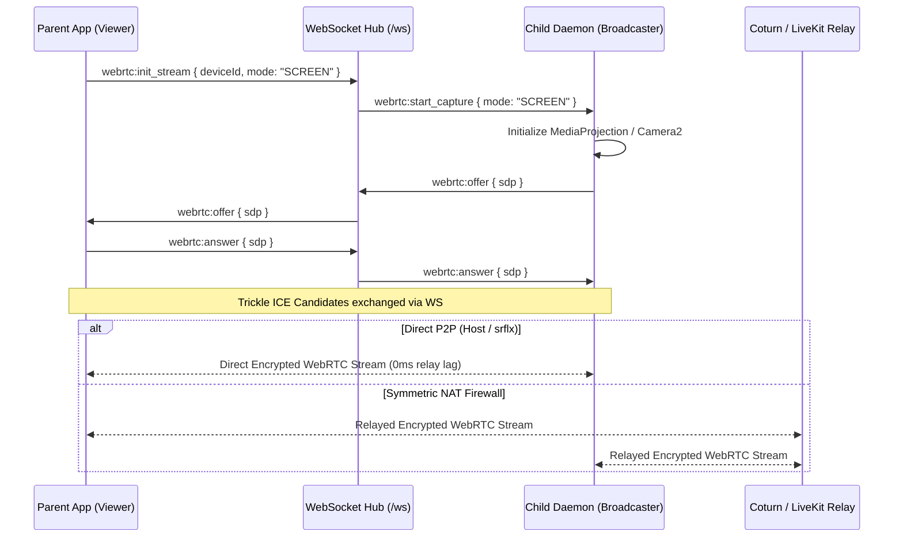

# Real-Time WebRTC Live Assistance & Media Streaming Specification
**Document:** `docs/parent-app/WEBRTC_STREAMING.md`  
**Application:** Parental Control — Parent App (Android Native)  
**Target Platform:** Android 8.0 (API 26) to Android 16 (API 36)  
**Engine:** Native Android WebRTC (`org.webrtc:google-webrtc`) + OpenGL ES Hardware Decoding  
**Signaling Protocol:** Persistent WebSocket Hub (`/ws`)  
**Status:** Canonical Live Streaming Authority  

---

## 1. Live Assistance Architecture Overview

The Parent App provides **Real-Time Live Assistance** to give parents immediate visual and auditory reassurance during emergencies or suspect situations.

```
+----------------------------------------------------------------------------------------------------+
|                                    LIVE ASSISTANCE ENGINE                                          |
+------------------------------------+---------------------------------------------------------------+
|  Stream Mode                       | Technical Pipeline & Parent Controls                          |
+------------------------------------+---------------------------------------------------------------+
|  1. Live Screen Mirroring          | 720p/1080p 30fps WebRTC video stream; landscape/portrait auto |
|  2. Remote Camera Stream           | Front/Rear camera feed with Flashlight & Night Mode toggle    |
|  3. One-Way Ambient Audio          | Low-latency Opus audio stream with live visualizer waveform   |
|  4. Still Capture Snapshot         | Lossless high-res still capture saved to Encrypted Gallery    |
+------------------------------------+---------------------------------------------------------------+
```



---

## 2. Jetpack Compose Hardware Surface Rendering (`SurfaceViewRenderer`)

In Jetpack Compose, WebRTC video tracks are rendered using an `AndroidView` that binds directly to native `SurfaceViewRenderer` with hardware EGLContext:

```kotlin
package com.parentalcontrol.parent.core.webrtc

import androidx.compose.runtime.Composable
import androidx.compose.ui.Modifier
import androidx.compose.ui.viewinterop.AndroidView
import org.webrtc.EglBase
import org.webrtc.RendererCommon
import org.webrtc.SurfaceViewRenderer
import org.webrtc.VideoTrack

@Composable
fun WebRtcVideoPlayer(
    videoTrack: VideoTrack?,
    eglBaseContext: EglBase.Context,
    modifier: Modifier = Modifier
) {
    AndroidView(
        factory = { context ->
            SurfaceViewRenderer(context).apply {
                init(eglBaseContext, null)
                setScalingType(RendererCommon.ScalingType.SCALE_ASPECT_FIT)
                setEnableHardwareScaler(true)
                videoTrack?.addSink(this)
            }
        },
        update = { view ->
            videoTrack?.addSink(view)
        },
        modifier = modifier
    )
}
```

### Key Hardware Optimizations:
1. **Direct GPU Decoding:** Hardware H.264 and VP8 decoders decode video packets directly into GPU memory without traversing CPU RAM, keeping phone temperature cool.
2. **Sub-120ms Latency:** Jitter buffer is tuned for interactive streaming (`playoutDelay = 50ms`).
3. **Adaptive Bitrate (ABR):** Automatically scales stream from 1080p down to 480p if child or parent enters weak cellular reception.

---

## 3. Remote Surroundings Camera Controls

When viewing the remote camera stream (`RemoteCameraViewerScreen`), the parent has real-time control toggles sent via WebSocket signaling:
* **Flip Camera:** Switches between front-facing (selfie) camera and rear-facing camera.
* **Flashlight Switch:** Activates child's rear camera LED torch for low-light visibility.
* **Night Mode Filter:** Software gamma booster for dark rooms.
* **Mute / Listen:** One-way audio stream toggle.
* **Still Photo Snapshot:** One-tap button that commands child device to capture full-sensor resolution still photo and upload directly to Cloudflare R2 presigned vault.

---

## 4. One-Way Ambient Surroundings Audio Visualizer & Scrubbable Player

### Live Ambient Audio Visualizer (Screen 31)
For `LiveAmbientAudioScreen` (Screen 31), the Opus audio stream feeds into a real-time Fast Fourier Transform (FFT) visualizer rendered via Compose Canvas:

```kotlin
@Composable
fun AudioWaveformVisualizer(
    amplitudes: List<Float>,
    modifier: Modifier = Modifier
) {
    Canvas(modifier = modifier) {
        val width = size.width
        val height = size.height
        val barWidth = width / (amplitudes.size * 2)

        amplitudes.forEachIndexed { index, amp ->
            val barHeight = height * amp.coerceIn(0.1f, 1.0f)
            val x = index * barWidth * 2
            val y = (height - barHeight) / 2

            drawRoundRect(
                brush = Brush.verticalGradient(
                    listOf(Color(0xFF6366F1), Color(0xFFA855F7))
                ),
                topLeft = Offset(x, y),
                size = Size(barWidth, barHeight),
                cornerRadius = CornerRadius(4f, 4f)
            )
        }
    }
}
```

### Scrubbable Recorded Audio Clip Player (Screen 53)
For recorded 30-second environmental clips (`RecordedAudioClipPlayerScreen`, Screen 53):
* **Playback Engine:** AndroidX Media3 / ExoPlayer streaming encrypted Opus/AAC audio from Cloudflare R2 presigned URLs.
* **Scrubbing & Seek:** Custom gesture-driven scrubbing bar with smooth drag state and instant seek-to-ms precision.
* **Variable Playback Speed:** 1-tap frosted chips for `0.5x`, `1.0x`, and `2.0x` playback pitch-preserved speed changes via ExoPlayer `PlaybackParameters`.
* **Waveform Cache:** 100 normalized amplitude points pre-calculated and stored in `ambient_audio_clips` table, rendering instant waveform visual without requiring on-device audio decode pass.

---

## 5. Quota Enforcement & Battery Safety

1. **Daily Minutes Cap:** High-definition video and audio streaming are gated by backend quotas (e.g. 30 minutes/day per family).
2. **Auto-Disconnect Guard:**
   * If the parent minimizes the app or turns off the screen, the WebRTC PeerConnection is automatically closed immediately to prevent battery drain on both phones.
   * If child battery drops below 15%, video streaming is automatically disabled with a warning: *"Child battery critical (14%). Video streaming paused to preserve child phone life."*

---

## 6. Live Screen Painting & Telestration Protocol (`PLivePaintActivity` Parity)

During live screen mirroring (`ScreenMirrorViewerScreen`), parents can draw directly on the child's screen in real time to guide them through homework, application settings, or warnings.

### DataChannel Stroke Message Format
Strokes are transmitted via WebRTC unordered DataChannel (`label = "telestration"`) with sub-25ms latency:

```json
{
  "type": "STROKE_EVENT",
  "action": "DOWN | MOVE | UP",
  "normalizedX": 0.4281,
  "normalizedY": 0.6514,
  "colorHex": "#00F5FF",
  "strokeWidthDp": 6.0,
  "timestamp": 1731531200000
}
```

* `DOWN`: User touches down on parent preview screen; begins new path.
* `MOVE`: QuadTo interpolation point transmitted; child draws immediately.
* `UP`: Touch lifted. Child device starts a 3.0-second fadeout animation before wiping the overlay from its screen.
* `CLEAR_ALL`: Instant wipe command when parent taps [Clear Canvas] in `LivePaintToolbarBottomSheet`.

---

## 7. Streaming Quality & Data Saver Adaptation

To prevent excessive cellular data bills, the WebRTC client negotiates dynamic constraints:

| Mode | Resolution | Target Bitrate | Frame Rate | Network Enforcement |
| :--- | :--- | :--- | :--- | :--- |
| **HD Pro** | 1080p (1920x1080) | 2,500 Kbps | 30 FPS | Wi-Fi Recommended |
| **Balanced** | 720p (1280x720) | 1,200 Kbps | 24 FPS | Wi-Fi or 5G/4G |
| **Data Saver** | 480p (854x480) | 600 Kbps | 15 FPS | Mobile Data |
| **Minimal** | 360p (640x360) | 350 Kbps | 12 FPS | Low Coverage / 3G |

When `wifiOnlyStreaming = true` is configured in `DataSaverSettingsScreen` (Screen 50), the client checks `ConnectivityManager.getNetworkCapabilities()`. If on Cellular, it halts connection and shows a frosted warning dialog with 1-tap override.

---

## 8. Multi-Clip Video Recording Merger (`MediaMuxer` Pipeline)

During live surveillance sessions, parents often record multiple short bursts (e.g. 10s of screen interaction, then 15s of camera feed).
* **Local Chunking:** Individual clips are encoded using Android's native `MediaCodec` (H.264 video + AAC audio) into temporary cache files (`temp_chunk_1.mp4`, `temp_chunk_2.mp4`).
* **Non-Blocking Merger:** Upon session end, Android's `MediaMuxer` extracts elementary video and audio tracks from each chunk without re-encoding and concatenates them into a single final MP4 file in `Movies/ParentalControl/`.
* If parent aborts merging via `dialog_merge_video_give_up`, temporary chunks are cleaned from disk immediately.

---

## 9. Session Duration Quota Timer

To prevent overheating of child hardware and excessive battery drain:
* The parent app enforces a **Session Countdown Timer** configured in `DataSaverSettingsScreen` (default: 10 minutes max per session).
* At 1 minute remaining, a subtle glowing yellow banner appears at the top of the video feed.
* At 0 minutes, the WebRTC peer connection closes gracefully with a polite toast: *"Session limit reached to protect child device battery"*.
